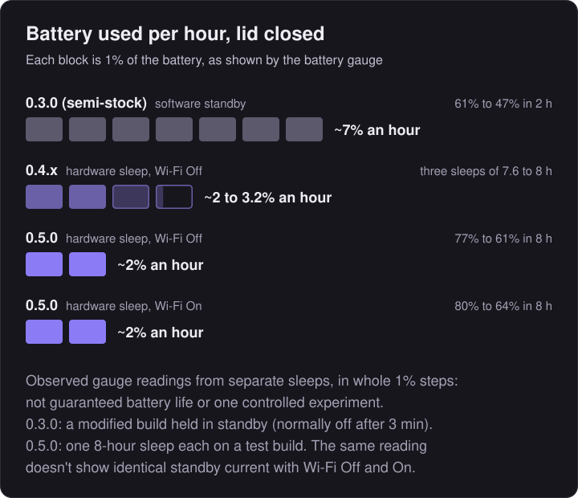

# slot.advance

**A Game Boy Advance focused build of [slot](https://github.com/BrandonKowalski/slot) for the Anbernic RG SP (2026).**

> [!IMPORTANT]
> **Supported device: Anbernic RG SP (2026) only**: the clamshell model with the 720 x 480 display. Not compatible with the older RG35XX SP. For that model or any other Anbernic device, use upstream [slot](https://github.com/BrandonKowalski/slot).

**Latest release: [slot.advance 0.4.2](https://github.com/suprsomething/slot.advance/releases/latest)** · **[Download&nbsp;ZIP](https://github.com/suprsomething/slot.advance/releases/download/advance-0.4.2/slot.advance-0.4.2-rg-sp.zip)**

[Install](#installing-and-updating) · [User guide](documentation/user-guide.md) · [Release notes](documentation/release-notes.md) · [Website](https://slotadvance.com)

---

## Features

- **Real hardware sleep.** Close the lid and your game waits in memory.
- **Fast resume.** Open the lid and you're back at the same moment, with nothing reloaded.
- **Sleep for 3 minutes to 8 hours**, then a clean automatic shutdown that restores the game at the next power-on.
- **All, Recents and Favourites** shelves, and a carousel that reopens on the last game played.
- **Five save states per game** in a switcher with previews, and a delete that asks first.
- **Per-game settings.** Each game remembers its shader, colour correction and fast-forward choices.

**How does it differ from slot?** [See the full comparison](documentation/user-guide.md#differences-from-slot).

slot.advance is a fork of **[slot](https://github.com/BrandonKowalski/slot)** by **Brandon T. Kowalski**. The carousel, the cart shelf, the save-state switcher, link play and nearly everything else you see is his work. This fork shapes it for one way of playing: GBA games on the 720 x 480 RG SP (2026).

## Screenshots

 The <b>All</b> shelf with a starred favourite (left), and the <b>save-state switcher</b> (right). Rendered by slot.advance's own drawing code with user-supplied Pokémon Unbound artwork.

---

## Sleep and battery

Close the lid and your game is saved and held in memory. Open it to carry on. If the sleep time runs out first, it shuts down cleanly and restores the game at the next power-on. Choose the time in **Settings > Sleep**, from 3 minutes to 8 hours.

In three extended sleeps with Wi-Fi off (the default), hardware sleep used about 2 to 3.2% of the battery an hour, against roughly 7% an hour for an earlier software-standby test build held in standby for two hours. Ordinary 0.3.0 shuts down after three minutes.

Observed battery-gauge readings over a small number of runs, not guaranteed battery life. [How it was measured, and how far the figures can be trusted](documentation/sleep-and-battery.md).

---

## Installing and updating

The download is a complete games-card layout for the RG SP (2026). It holds no games, saves or settings, and following the upgrade instructions below preserves your existing ones. slot.advance runs on the same system card (SD1) as slot; if your RG SP (2026) already runs slot, skip to **Upgrading**.

### New install

1. Follow the [slot guide](https://slot-cfw.fyi) to set up the system card (SD1) for the RG SP (2026).
2. Put your games card (SD2) in your computer, formatted as the slot guide describes.
3. Unzip the download, `slot.advance-<version>-rg-sp.zip`. On a Mac, double-clicking it makes a folder of the same name.
4. Open that folder and copy **everything inside it** (`BIOS`, `Config`, `Games`, `Labels`, `Saves`, `States`, `System`, `Wallpapers`) onto the top level of the games card. Copy the contents, not the folder itself.
5. Put your `.gba` files in `Games/GBA` and, if you have it, the GBA BIOS (`gba_bios.bin`) in `BIOS`.
6. Eject the card, put it in the RG SP (2026)'s second slot, and power on. Set the clock when asked.

> [!IMPORTANT]
> ROMs must be unzipped. slot does not read `.zip` or `.7z` files.

### Upgrading

1. Power off the RG SP (2026), then put the games card (SD2) in your computer.
2. *Optional:* to keep a way back, rename `System/slot` on the card to `slot.previous`.
3. Unzip the download and open its `System` folder. Select **everything inside it** and drag it into the `System` folder on the card. When asked, choose **Replace**. Your games, saves, states, favourites and settings are not in `System`, so they stay as they are.
4. Eject the card, put it back, and power on.

> [!WARNING]
> On a Mac, don't drag the download's top-level folders (`Games`, `Saves`, `States` and so on) onto the card's folders of the same name. They are empty, and Finder's **Replace** swaps a whole folder for the empty one, deleting what was in it. When upgrading, only the contents of `System` need copying.

Going back to an earlier version is covered in the [User guide](documentation/user-guide.md#going-back).

---

## Controls

| Button | What it does |
|---|---|
| `L2` / `R2` | Switch between All, Recents and Favourites |
| `Y` | Add or remove a favourite |
| Tap / hold `A` | Resume where you left off / start the game fresh |
| Double tap `MENU` in game | Open the save-state switcher |
| Close the lid, or tap `POWER` | Save and sleep |

Link play needs Wi-Fi, which is off by default. To use it, add the line `wifi=on` to `Config/slot.state` on the games card and restart.

Every control and setting is in the **[User guide](documentation/user-guide.md)**.

---

## Help

- **Screen still dark after a quick lid flick?** Close the lid and open it again. Your game carries on.
- **Found a bug?** Before you power on again, copy `slot.log` and `slot.log.1` from the games card, plus `crash/cores.log` and the newest `crash/slot-….log` if there is a `crash/` folder. The next start-up replaces the logs. Then [open an issue](https://github.com/suprsomething/slot.advance/issues/new/choose). The full steps, troubleshooting and known limitations are in the [User guide](documentation/user-guide.md#troubleshooting).

---

## Documentation

**For players:** [User guide](documentation/user-guide.md) · [Release notes](documentation/release-notes.md) · [slotadvance.com](https://slotadvance.com)

**For developers:** [Technical reference](documentation/technical.md) · [Sleep and battery measurements](documentation/sleep-and-battery.md) · [Building](documentation/building.md)

This build: **0.4.2** · [All releases](https://github.com/suprsomething/slot.advance/releases)

---

## Credits

- **[slot](https://github.com/BrandonKowalski/slot)** by Brandon T. Kowalski: the frontend this fork is built on. The cart sounds are recordings of his childhood Game Boy.
- **slots** by **[ciscosweater](https://github.com/ciscosweater)**: the Recents category is adapted from this community fork of slot, and its favourites tab inspired ours.
- **[mGBA](https://mgba.io)** by endrift and **[gpSP](https://github.com/libretro/gpsp)** through [libretro](https://www.libretro.com): the emulation. **[AGS-102](https://github.com/BrandonKowalski/AGS-102)**, a fork of [BaseOS](https://github.com/pvaibhav/BaseOS) by @pvaibhav: the operating system slot boots on.
- **[Open Sans](https://github.com/googlefonts/opensans)** (SIL Open Font License) and **[Nerd Fonts](https://www.nerdfonts.com)** symbols by Ryan L McIntyre (MIT), including the favourite star. The LCD3x screen shader's panel mask is derived from **gigaherz's LCD3x** ([shader credits and licences](licenses/shaders.txt)).
- The cartridge-label photographs in the [starter pack](artwork/gba-originals) are credited to their photographers in its README. Both slot and slot.advance were built with **Claude** (see [AI disclosure](#ai-disclosure)).

slot.advance is released under the same licence as slot, the [GNU GPL v3 or later](LICENSE).

### AI disclosure

slot's Rust frontend was put together with Claude Opus and reviewed by its author. The changes in this fork were also written with Claude (Anthropic), at my direction, and checked with slot's own automated test suite plus new tests for each feature. The battery charts and README screenshots were generated from the development test results and slot.advance's own drawing code.
