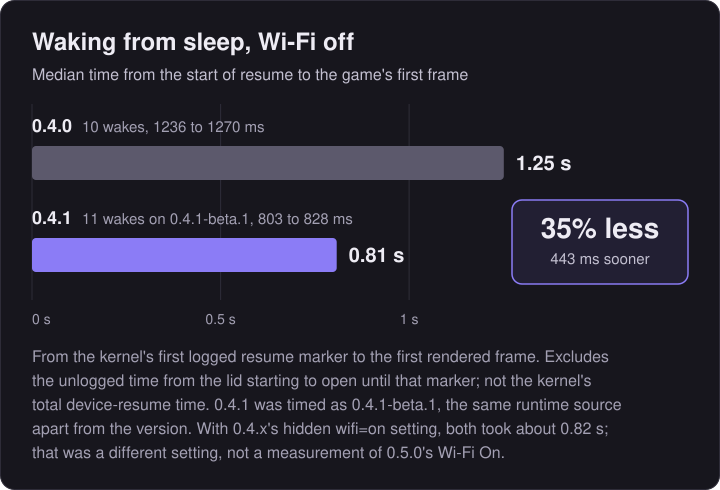
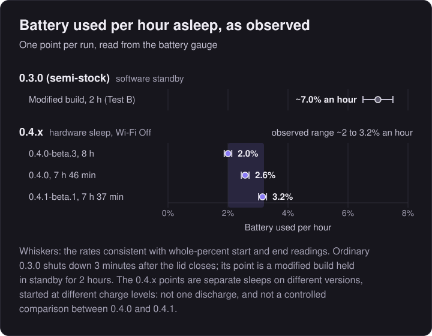
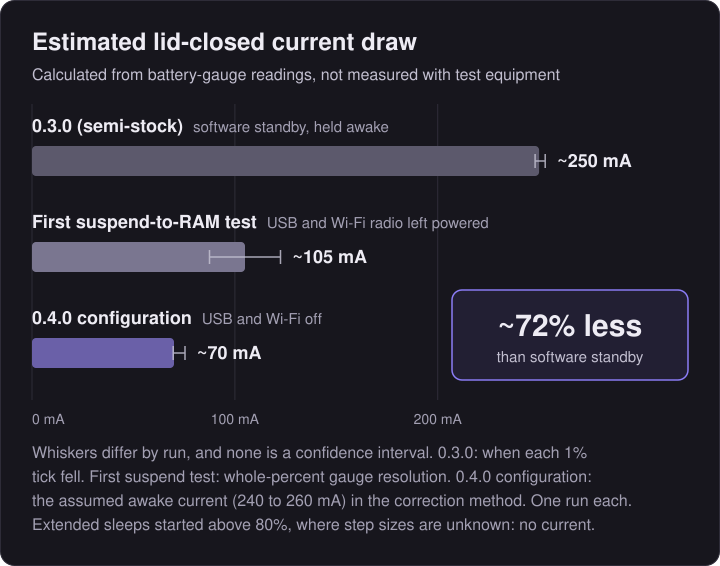
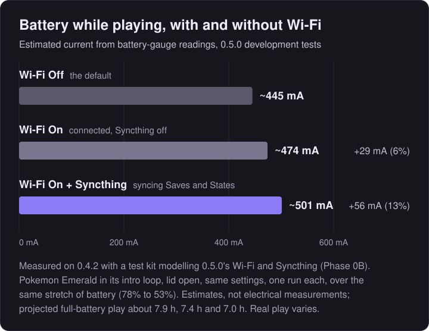

# Sleep and battery: how it evolved and how it was measured

This page is the detail behind the sleep, wake-up and battery figures in the [README](../README.md). It covers how sleep has changed across slot.advance's releases, what 0.4.0 does when the lid closes, why 0.4.1 wakes faster, how the figures were obtained, how far they can be trusted, and what was checked on the device before each release. How the current release works, with the source files involved, is in the [Technical reference](technical.md).

Everything here applies to the **Anbernic RG SP (2026)** (720 x 480 screen) running BaseOS 1.3.0 (Linux 4.9). Version numbers are **slot.advance** versions, not upstream slot's. <!-- RELEASE-PREP: provisional until 0.5.0 is released. --> **0.5.0** (tag `advance-0.5.0`) is the current release. With Wi-Fi off, the default, it sleeps and wakes as 0.4.1 and 0.4.2 do; what it adds, optional Wi-Fi and Syncthing, and how that was measured, is in [0.5.0: Wi-Fi and Syncthing](#050-wi-fi-and-syncthing). **0.4.2** (tag `advance-0.4.2`) changed nothing in sleep, wake, Wi-Fi or power management, so everything here that applies to 0.4.1 applies to it. **0.4.1** (tag `advance-0.4.1`) was released after the checks under [Validation status](#validation-status). It is 0.4.0 with one change, described in [Waking up faster in 0.4.1](#waking-up-faster-in-041). **0.4.0** (tag `advance-0.4.0`) introduced hardware sleep; **0.3.0** (tag `advance-v3`) came before it.

## Contents

- [Summary](#summary)
- [The evolution of sleep](#the-evolution-of-sleep)
- [What 0.4.0 does when the lid closes](#what-040-does-when-the-lid-closes)
- [Waking up faster in 0.4.1](#waking-up-faster-in-041)
- [Battery results](#battery-results)
- [0.5.0: Wi-Fi and Syncthing](#050-wi-fi-and-syncthing)
- [Methodology and uncertainty](#methodology-and-uncertainty)
- [Raw reports and calculations](#raw-reports-and-calculations)
- [Validation status](#validation-status)

---

## Summary

These are the historical measurements behind hardware sleep, made from 0.3.0 to 0.4.1 with Wi-Fi off or, in the development runs, with it on and unconfigured. The 0.5.0 Wi-Fi On and Syncthing measurements are [in their own section](#050-wi-fi-and-syncthing).

| Lid closed | Observed battery drop | Estimated current | Source |
|---|---|---|---|
| 0.3.0 (semi-stock), software standby, modified build held awake | 61% to 47% in 2 hours (~7% an hour) | ~250 mA (248 to 253) | Test B |
| First suspend-to-RAM test, USB and Wi-Fi on | 68% to 62% in 2 hours (~3% an hour) | ~105 mA (87.5 to 122.5) | Test A |
| 0.4.0-beta.3, USB and Wi-Fi off | 98% to 82% in 8 hours (~2% an hour) | Not converted (above 80%; see below) | Overnight sleep, tester's notes |
| 0.4.0, USB and Wi-Fi off | 94% to 74% in 7 h 46 min (~2.6% an hour) | Not converted (above 80%; see below) | Overnight sleep, night A log |
| 0.4.1-beta.1, USB and Wi-Fi off | 99% to 75% in 7 h 37 min (~3.2% an hour) | Not converted (above 80%; see below) | Extended sleep, night B log |
| 0.4.0 configuration, reproduced | 77% to 74% in 1.5 hours (~2% an hour) | ~70 mA (70 to 75) | Experiment 5, segment 3 |

**0.3.0 (semi-stock)** is how comparisons on this page and in the README label slot.advance 0.3.0 (tag `advance-v3`): it still used software standby, with improvements over upstream slot's (it stops drawing once the screen is dark). Its figures come from a modified build, not from upstream slot. **0.4.x** pools the hardware-sleep observations from 0.4.0-beta.3, 0.4.0 and 0.4.1-beta.1.

- **About 2 to 3.2% an hour on the battery gauge, across three extended sleeps on 0.4.x.** On 0.4.0, two overnight sleeps showed 2 to 2.6% an hour: 0.4.0-beta.3 went from 98% to 82% in 8 hours (~2% an hour), and 0.4.0 from 94% to 74% in 7 hours 46 minutes (~2.6% an hour). On the 0.4.1 candidate, a third went from 99% to 75% in 7 hours 37 minutes (~3.2% an hour). The range is reported as observed rather than averaged. It is not a guaranteed or statistically established range, nor a controlled measurement of the difference between releases.
- All currents are **estimates calculated from the battery gauge**, not measured with electrical test equipment. They rely on the battery's nominal 3,500 mAh capacity and on assumptions about the gauge's calibration. The ranges shown reflect each test's method, not every possible systematic calibration error. No independent current measurement was made.
- **About 72% less** estimated standby current, which supports the hourly figures: (250 - 70) / 250, from Test B's ~250 mA and Experiment 5's ~70 mA. Experiment 5 ran below 80%, where the gauge's step sizes were estimated, and its range of 70 to 75 mA gives 70% to 72%. The 72% is not calculated from the hourly rates.
- **Whether 0.4.0 and 0.4.1 use the same standby battery is inconclusive.** The 0.4.1 sleep started at 99%, straight after power-on; the 0.4.0 one started at 94%, after the gauge had fallen five points in 22 minutes awake. The top of the gauge is unmeasured and its steps are uneven, and the three extended sleeps weren't read the same way (0.4.0-beta.3's end reading came after a timer shutdown and a power-on), so the readings can't show parity, and the difference isn't evidence of a regression either.
- **The extended sleeps are not converted to a current.** All three ran above 80%, where the gauge's 1% steps are smaller than 35 mAh and, above about 85%, unmeasured. Converted with the one step size estimated up there, the two 0.4.0 nights would give about 53 and 74 mA, which do not agree; see [the overnight sleeps](#methodology-and-uncertainty). The current figures stay with the runs where the step size was estimated.
- **Ordinary 0.3.0 shuts down 3 minutes after the lid closes.** Its hourly figure describes a test build deliberately held in standby. A switched-off device draws only a negligible amount compared with any standby, so 0.4.0's benefit is staying asleep efficiently for hours with instant lid wake, not lower consumption than switching off.
- No change to battery use **during gameplay** has been measured, and none is claimed.

---

## The evolution of sleep

| | Upstream slot | 0.3.0 (semi-stock) | slot.advance 0.4.0 |
|---|---|---|---|
| CPU | Running | Running, mostly idle | Suspended |
| Drawing | A black frame every display refresh (~60 a second) | Two black frames, then none | None |
| Display | Backlight off | Backlight off | Suspended by its driver |
| Memory | Active | Active | Kept powered; the game is preserved |
| Unused USB host controllers and Wi-Fi | On | On | USB hosts off after start-up; Wi-Fi off by default after at least 20 seconds of system uptime |
| Emulator | Paused | Paused, no longer ticked | Paused, then frozen with the whole system |
| After the lid closes | Powers off after 3 minutes | Powers off after 3 minutes | Sleeps for the chosen time (3 min to 8 hr), then shuts down cleanly |
| Observed battery per hour, lid closed | Not measured | ~7% (modified build held awake) | ~2 to 3.2% (0.4.x, three extended sleeps) |
| Estimated lid-closed current | Not measured | ~250 mA (modified build held awake) | ~70 mA |

**Upstream slot** (verified in its source, `crates/slot/src/device_app.rs` at the fork point): closing the lid turns off the backlight and pauses the game, but the main loop keeps running at the display's refresh rate (about 60 Hz). Each pass draws a full-screen black rectangle and swaps buffers. After 3 minutes it powers off, and the next boot restores the game from its suspend slot. Its standby current was never measured.

**slot.advance 0.3.0**, labelled **0.3.0 (semi-stock)** in comparisons (`crates/slot/src/standby.rs`): once the screen is dark, it draws two black frames and then stops drawing and stops ticking the emulator. It wakes every 50 ms to read input, poll the lid (every 150 ms) and run its timers. The CPU, memory and display hardware stay powered. Test B logged zero GPU interrupts a minute in this state, with the CPU governor at `performance`, 1.512 GHz. The 3-minute power-off is unchanged.

**slot.advance 0.4.0**: real Linux suspend-to-RAM, described next.

---

## What 0.4.0 does when the lid closes

This is the sleep configuration the battery and wake-up tests ran on, as described for 0.4.0. 0.4.1 behaves the same apart from the stale Wi-Fi card removal below. The maintained description of the current implementation is the [Technical reference](technical.md).

1. **Save first.** The game's suspend slot (`resume.state`) and battery save are written and flushed to the card before anything else (`App::doze`). If the write fails, it is retried once. A game that still can't be saved is marked unsaved (see below).
2. **Settle.** Drawing stops as in 0.3.0. After a 400 ms pause, so a quick flick of the lid never reaches the kernel, slot.advance arms a wake alarm and suspends.
3. **Suspend to RAM.** slot.advance writes `mem` to `/sys/power/state` (`crates/slot-power/src/sleep.rs`). This is suspend-to-RAM, not the lighter `freeze` (suspend-to-idle). The kernel freezes all processes, suspends device drivers (the display among them), takes the secondary CPU cores offline and hands the last one to the platform firmware. Memory stays powered. Which power rails stay on is decided by the firmware, not Linux.
4. **Wake sources.**
   - **Lid:** the power chip's driver has an `os_sleep` setting. BaseOS writes `16` ("Super Standby") at every boot, in which the lid is not a wake source. slot.advance writes `0` ("Normal Standby") at startup, which makes the hall sensor a wake source through the power-key device. It refuses to suspend if the lid isn't armed.
   - **Timer:** the SoC's real-time clock (`sunxi-rtc`, found by name, never by number) with a relative alarm. The deadline is counted on the kernel's uptime clock, which keeps counting through suspend, so it always runs from the lid closing.
   - **`POWER`**, and incidental events from the power chip such as a charger.
5. **Classify every wake** (`crates/slot/src/sleep.rs`). Lid open: carry on playing, nothing reloaded. Deadline reached: shut down cleanly; the next boot restores the game from `resume.state`. Anything else (`POWER` with the lid shut, a charger, a stray event): back to sleep with the screen dark and the same deadline. More than 20 unexpected wakes in one sleep, or a suspend that fails twice, falls back to 0.3.0's software standby for that sleep.

**Unused hardware** (`crates/slot-power/src/quiet.rs`). At startup, slot.advance switches off the six USB host controllers `ohci1-3` and `ehci1-3` through their sysfs switches. The RG SP (2026)'s USB-C port uses a separate controller (`5100000.udc`, with `ehci0`/`ohci0`) and is not touched. Once BaseOS has finished starting Wi-Fi (uptime 20 s), slot.advance unloads the `8821cs` driver, which cuts the radio's supply rail, unless `wifi=on` is set. Both are logged and optional, hardware sleep never depends on either, and both last only until the next boot. They stay off during gameplay too; no gameplay battery effect has been measured.

**From 0.4.1**, straight after unloading the Wi-Fi driver, slot.advance also removes the radio's stale card from the kernel; see the next section.

**Battery cap.** Sleep is planned to aim to preserve approximately 10% of the battery. It assumes a deliberately pessimistic 100 mA, so the device wakes and shuts down early if the chosen time would go below about 10%. This is a plan based on the gauge, not a guarantee. At 10% or less it sleeps for 3 minutes, as 0.3.0 did. The 5% shutdown from slot still applies.

**Save safety.** A game that could not be written when the lid closed is never shut down by the timer. Instead, the device keeps sleeping and retries the save at each deadline, and only the 5% battery shutdown can end it. This now includes the case where the emulator core fails to provide its state. Before commit `dbbadae`, that case was wrongly reported as saved. A core that is still loading, or failed to start, has no progress to lose and is treated as saved.

### The lid-wake trade-off

Experiment 5 compared the same hardware with lid wake armed (Normal Standby, segment 3, ~70 mA) and with the firmware's deeper Super Standby (segment 4, ~64 mA, lid not armed). Lid wake costs roughly 7 to 9 mA, about 10%. slot.advance keeps it, because waking by opening the lid is the point of sleeping instead of switching off.

---

## Waking up faster in 0.4.1

<p align="center">

</p>

| Wi-Fi off (the default) | 0.4.0 | 0.4.1-beta.1 |
|---|---|---|
| Median first frame after resume starts | **1,251 ms** | **808 ms** |
| Range | 1,236 to 1,270 ms | 803 to 828 ms |
| Wakes timed (all resumed) | 10 | 11 |
| Difference | | 443 ms sooner, 35.4% less measured time |

**What was measured.** A read-only watcher logged real lid closes of about 15 seconds with a game running, on the kernel's own log clock. Each time runs from **resume start** (the kernel's `Enabling non-boot CPUs`, the first thing it logs on waking) to the **first GPU interrupt**, which is slot.advance's first rendered frame (it draws nothing while asleep). These are first-frame times, not the kernel's total device-resume duration (its own "resume of devices complete" figure, which is shorter). The moment the lid starts to open isn't logged, so the time between that and the first resume marker isn't included; the 443 ms saving is all inside the measured part, so it is a smaller share of the whole wait a player sees than 35%. "35% less resume time" in the release notes refers to this measured interval, with Wi-Fi off. The 0.4.0 figures are experiment R2 (14 October 2026); the 0.4.1-beta.1 figures are V1 (15 October 2026), with the same watcher, procedure and device. 0.4.1's runtime source is 0.4.1-beta.1's with only the version changed, so the V1 figures are reported for 0.4.1; the released binary itself was not timed on the device. R2's own report was not kept: its figures survive in the project's notes and in `first-frame.py`, which recalculates the 0.4.1-beta.1 median and the comparison arithmetic but cannot reconstruct R2's individual samples. The polling behind the first-frame mark is accurate to about 10 to 20 ms.

**Why 0.4.0 was slower.** From 0.4.0, slot.advance switches Wi-Fi off about 20 seconds after start-up by unloading the `8821cs` driver, which also cuts the radio's supply. But the kernel kept the radio's SDIO card registered on its slot (`mmc2`). On every resume, it tried to wake that unpowered card and waited about 1.1 s for it to time out (`mmc2: error -110 during resume`), before handing control back to programs.

**What 0.4.1 changes** (`crates/slot-power/src/quiet.rs`). Once, at start-up, straight after a successful driver unload with the radio confirmed unpowered, slot.advance writes `1` to `rf-ctrl/scan_device`, the same step BaseOS's own start-up script uses to discard a stale card before loading the driver. The card goes within about 15 ms, and later resumes have nothing to wait for. Before writing, it checks that the slot holds only the Wi-Fi card (never either TF card) and that the radio's power rail is off; if any check fails, it changes nothing and resumes exactly as 0.4.0 did. Each outcome is written to `slot.log`, for example `slot: quiet: stale wifi card mmc2:0001 discarded in 15 ms`. The full list of checks and outcomes is in the [Technical reference](technical.md#the-041-wi-fi-card-removal).

**What it doesn't change.** It isn't a new way of sleeping: the suspend itself, the lid and timer wakes, and the radio's power state are exactly as in 0.4.0. With `wifi=on` the driver stays loaded and nothing is removed, so those wakes take about 0.82 s on both versions, the driver resuming the radio instead: a median of 820 ms over 9 wakes on 0.4.0, and 825 ms on 0.4.1-beta.1. On the candidate, 10 `wifi=on` wakes all resumed, but the watcher timed only 7 of them (the V1 report explains the three it missed), so the 825 ms median is of those 7. No improvement is claimed with `wifi=on`; the 35% applies to the Wi-Fi-off configuration only.

**Start-up race (accepted limitation).** If the lid closes at almost exactly the moment the driver is being unloaded, about 20 seconds after power-on, the kernel holds the removal back while it suspends and doesn't repeat it afterwards. That session's wakes then take as long as in 0.4.0; sleep and wake still work normally, and the next power-on removes the card as usual. `slot.log` reports it as `stale wifi card discard FAILED`. Targeted testing (V2), with lid closes deliberately aimed at that window, reproduced it once; it was accepted rather than adding a retry to the suspend path.

---

## Battery results

### Observed battery per hour (0.4.x, Wi-Fi off)

<p align="center">

</p>

<sub>One point per run. Whiskers show the rates consistent with whole-percent start and end readings, one point either way over the time asleep. Ordinary 0.3.0 shuts down 3 minutes after the lid closes; its point comes from a modified build held in standby for 2 hours (Test B), not extended to longer sleeps. The three 0.4.x points are separate sleeps on 0.4.0-beta.3, 0.4.0 and 0.4.1-beta.1, started at different charge levels; they are not one discharge, and the range is pooled across 0.4.x rather than measured on any one version. Details are under [the overnight sleeps](#methodology-and-uncertainty).</sub>

The battery percentage per hour is the primary figure here, because it is what the gauge shows and what a player sees. The first suspend-to-RAM test (Test A, ~3% an hour with USB and Wi-Fi still on) and Experiment 5 are development runs, kept in the [summary](#summary) and the [methodology](#methodology-and-uncertainty) rather than in this comparison.

### Sleep-duration projections

| Asleep for | Battery used | Basis |
|---|---|---|
| 15 min | ~0.5 to 0.8% | Projected |
| 30 min | ~1 to 1.6% | Projected |
| 1 hr | ~2 to 3.2% | Projected |
| 1.5 hr | 3% (77% to 74%) | Measured once, Experiment 5 |
| 2 hr | ~4 to 6.4% | Projected |
| 4 hr | ~8 to 12.8% | Projected |
| 7 h 37 min | 24% (99% to 75%) | Measured once, 0.4.1-beta.1 |
| 7 h 46 min | 20% (94% to 74%) | Measured once, 0.4.0 |
| 8 hr | 16% (98% to 82%) | Measured once, 0.4.0-beta.3 |
| 8 hr | ~16 to 26% | Projected |

Projected rows are mathematical projections from the lowest and highest 0.4.x extended-sleep rates, 2 and 3.2% an hour, not measurements at every duration. Measured rows are single runs read in whole percent. For 0.4.0 alone, the two overnight sleeps gave 2 to 2.6% an hour. Real use varies with battery age, temperature and charge level.

### Estimated current

<p align="center">

</p>

<sub>Bars are estimates calculated from battery-gauge readings, one run per configuration, not electrical measurements. The whiskers have different origins and none is a statistical confidence interval: for 0.3.0 (semi-stock), the bounds from when each 1% tick fell (248 to 253 mA); for the first suspend test, whole-percent gauge resolution (87.5 to 122.5 mA); for the ~70 mA configuration, the sensitivity of the correction method to the assumed awake current, 240 to 260 mA (69.6 to 75.4 mA).</sub>

The estimates explain the hourly figures: the change from software standby to hardware sleep cut the estimated current from about 250 mA to about 70 mA, about 72% less (see [Summary](#summary) for the working and its assumptions). The extended sleeps are not converted to a current.

---

## 0.5.0: Wi-Fi and Syncthing

*Development measurements for the 0.5.0 networking design, from Phase 0 (R3, 0B, 0C) and the 0.5.0 validation builds (V1). Recalculated by [`calculate-0.5.0.py`](battery-tests/calculate-0.5.0.py).*

<!-- RELEASE-PREP: the raw reports behind this section are in the project's working folder, not in this repository yet. Add them under battery-tests/ and wake-tests/ (as for 0.4.x) and point calculate-0.5.0.py at them, or keep this note. -->

**With Wi-Fi off (the default), nothing here changes**: the driver is unloaded about 20 seconds after start-up exactly as in 0.4.1 and 0.4.2, and the 0.4.x results above apply. What 0.5.0 adds is **Wi-Fi On**, in which the driver stays loaded, and **Syncthing**, which runs only with Wi-Fi On. The design rule, set by the measurements below, is that the game is saved first and then **`wlan0` is disconnected and taken down before every hardware sleep**, whether or not it ever connected. How that works is in the [Technical reference](technical.md#wi-fi-and-sleep).

The figures below are of four kinds, labelled as such:

- **Measured gauge reading:** the battery percentage the gauge showed, in whole 1% steps.
- **Estimated current:** milliamps calculated from timed gauge steps (35 mAh each), as in [Methodology and uncertainty](#methodology-and-uncertainty). Not measured with electrical test equipment.
- **Projected:** arithmetic from an estimate, such as battery life from a current. Not observed.
- **Assumption:** an engineering judgement the measurements don't test directly.

### Asleep

| Run | Build and state before sleep | Result | Kind |
|---|---|---|---|
| V1-B, October 2026 | 0.5.0 test build 1, Wi-Fi Off; 8-hour sleep on the timer | 77% to 61%: 2.0% an hour (1.88 to 2.12 within whole-percent readings) | Measured gauge reading |
| V1-D, 24 October 2026 | 0.5.0 test build 1, Wi-Fi On, connected, then taken down before sleeping; 8-hour sleep (28,797 s) on the timer | 80% to 64%: 2.0% an hour (1.88 to 2.13) | Measured gauge reading |
| Phase 0C, C90, 20 October 2026 | 0.4.2 with a test kit modelling the 0.5.0 design: connected, then disconnected and `wlan0` down; 90 minutes | ~66 mA | Estimated current (3 gauge steps) |
| Phase 0C, C30, 20 October 2026 | As C90; 30 minutes | ~74 mA (± 7, mostly from the awake-current estimate) | Estimated current (2 gauge steps) |
| Phase 0C, R, 20 October 2026 | Experimental: driver loaded, never connected, `wlan0` left up as BaseOS leaves it; 60 minutes | ~102 mA | Estimated current (3 gauge steps). **Not 0.5.0's behaviour** |

What these show, and what they don't:

- **Sleeps prepared as 0.5.0 prepares them came out close to Wi-Fi off.** The two estimates, 66 and 74 mA, are close to Experiment 5's ~70 mA for Wi-Fi off, and the two 8-hour sleeps on the same 0.5.0 test build read the same 2% an hour on the gauge, one with Wi-Fi off and one with Wi-Fi on.
- **They don't show that every 0.5.0 sleep uses 66 to 74 mA, or that Wi-Fi On and Off use identical standby power.** The estimates rest on two or three gauge steps each, from one session that started its sleeps from the boot screen rather than from a game. The comparison with Wi-Fi off is across different sessions, not the same night. The two 8-hour sleeps were single runs; with whole-percent readings at each end, a difference of up to two gauge steps over 8 hours (about 9 mA) couldn't be ruled out.
- **The 102 mA segment is why `wlan0` is taken down.** Suspending with the interface up and idle took the driver down a different suspend path in the kernel log (`rtw_suspend_normal: ### ERROR #### driver in IPS`) and was followed by a higher awake current. **Inferred, not established:** that the radio stays in a higher-power state through that kind of sleep. It was one segment and is not representative of 0.5.0, which never sleeps in that state. (Before 0.5.0, a hand-written `wifi=on` for link play did.)
- Syncthing doesn't run while asleep: it is frozen with every other process during suspend.

### Awake, while playing

<p align="center">

</p>

| Phase 0B run (19 October 2026) | Estimated current | Difference | Projected play from full |
|---|---|---|---|
| B1: Wi-Fi Off | 445 mA (standard error 3.9) | | ~7.9 h |
| B2: Wi-Fi On, connected, Syncthing off | 474 mA (3.6) | +29 mA (Wi-Fi) | ~7.4 h |
| B3: Wi-Fi On, Syncthing syncing Saves and States with a home server | 501 mA (2.4) | +27 mA more (Syncthing); +56 mA, about 13%, in all | ~7.0 h |

- **Method.** slot.advance 0.4.2 with a test kit whose network helper played the part of 0.5.0's Wi-Fi and Syncthing. Pokémon Emerald on mGBA in its intro loop, lid open, no input, unplugged, with the same volume, brightness and settings in every run. Each run is compared over **the same stretch of battery, 78% to 53%**, because current rises as the voltage falls. One run per configuration.
- **What is solid.** Each difference is about five times its standard error, so Wi-Fi and Syncthing really do add current while awake on this device.
- **What isn't.** The gauge's own calibration error is unknown, and matching the battery range reduces but doesn't remove it. One network (with its own background traffic), one workload, one run each. The projected play times divide 3,500 mAh by the estimate and ignore the rise in current as the battery empties: they are rough, and **not guaranteed battery life**.
- **Inferred, not measured:** the Wi-Fi cost comes with about 8 MB an hour of background traffic received on that network, and the Syncthing cost mostly with uploading the suspend slot that slot.advance saves every minute (about 25 MB an hour). The split was not measured separately.

### Waking up

| R3 session (17 October 2026, 0.4.2) | Resume start to first frame, median (range) | Wakes |
|---|---|---|
| A: Wi-Fi off (driver unloaded, as 0.4.1, 0.4.2 and 0.5.0 with Wi-Fi Off) | **819 ms** (807 to 829) | 13 |
| B: driver loaded, never connected | 844 ms (827 to 872) | 12 |
| C: driver loaded, connected, then disconnected and `wlan0` down before each sleep (0.5.0's Wi-Fi On design) | **834 ms** (814 to 854) | 14 |

- **Measured:** keeping the driver loaded added about 15 to 25 ms (one or two display refreshes) to an ~0.82 s wake, with no `mmc2` timeouts, failed suspends or unexpected wakes. Session C reconnected after all 14 wakes, in a median of 6.7 seconds, in the background. **Assumption:** a difference of 15 to 25 ms isn't noticeable.
- R3 used the same definitions and watcher as the 0.4.1 measurement above, but **it is a separate experiment**: a different session, build (0.4.2) and charge level. Its 819 ms is not part of the 0.4.0 to 0.4.1 comparison (1,251 to 808 ms), and the two shouldn't be read as one controlled series.
- **Not timed on a 0.5.0 build.** The 0.5.0 validation builds resumed reliably with Wi-Fi On and Off (V1: 14 sleeps with Wi-Fi Off and 13 with Wi-Fi On during play, every one resumed), but first-frame times were not separately measured on them.

---

## Methodology and uncertainty

**Instrument.** The only measurement available on the device is the battery gauge. Its `charge_counter` is just the battery percentage multiplied by the 3,500 mAh design capacity: every reading is a multiple of 35,000 µAh. So the real resolution is one percent, **35 mAh**.

**Test B (0.3.0 software standby).** This used a test build of 0.3.0 whose only change was a 3-hour standby timeout instead of 3 minutes, so standby could be held for 2 hours. With the lid closed, a logger recorded the gauge every minute. From the start and end readings alone, the figure is 245 ± 17.5 mA. Because each 1% tick can be timed to within a minute, the 13 full steps between the first and last tick pin it down to **248 to 253 mA**. The ticks came every 7 to 9 minutes throughout, so the drain was steady.

**Test A (first suspend-to-RAM).** One `mem` suspend lasted 2 hours, with lid wake armed and USB and Wi-Fi on. The device was awake for only 2.35 s of the 7,201 s interval. The battery fell from 68% to 62%. Each end reading could be anywhere within its 1% band, so the result is **105 ± 17.5 mA**. *The raw report prints ±2.5 mA. That assumed 5 mAh steps, before Test B showed the step is 35 mAh, and it is wrong.*

**Experiment 5 (where the current goes).** This was one overnight run of four 90-minute suspends, each adding one change. Each segment ran from one 1% tick to the first tick after waking. The device then stayed awake until the next tick, to measure its awake current for the time it spent awake inside the segment.

| Segment | Configuration | Battery while asleep | Raw estimate (35 mAh steps) | Assuming 240 / 250 / 260 mA awake |
|---|---|---|---|---|
| 1 | Normal Standby, lid armed, USB and Wi-Fi on | 89% to 84% | 130.9 mA | 94 / 98 / 102 mA |
| 2 | + USB host controllers off | 82% to 79% | 77.2 mA | 66 / 69 / 71 mA |
| 3 | + Wi-Fi off (**the 0.4.0 configuration**) | 77% to 74% | 69.8 mA | 70 / 73 / 75 mA |
| 4 | Super Standby, lid not armed | 72% to 70% | 62.6 mA | 61 / 64 / 66 mA |

**The gauge isn't linear at high charge.** Above about 80%, one percent step worked out to about 26 mAh instead of 35. That is why segment 1's raw figure, 131 mA, is far above Test A's 105 mA for the same configuration. The right-hand column sidesteps step size: within a segment, the asleep and awake readings come from the same part of the gauge, so their ratio doesn't depend on the step. That ratio is then scaled by an assumed awake current (Test B measured 250 mA). Below 80%, the raw and corrected figures agree. Segment 3, at 77% to 73%, gives 69.8 mA raw and 70 to 75 mA corrected. *The raw report's ±0.5 mA figures ignore this effect and are too optimistic.*

**What the comparisons support.**
- The two runs of the baseline configuration agree within their uncertainty: Test A at 105 ± 17.5 mA, and segment 1 at about 98 mA corrected.
- USB off (segment 1 to 2) gave the largest single saving, roughly 30 mA. This rests on one run, and its exact size is mixed up with the high-charge gauge error.
- Wi-Fi off showed no saving that could be separated from noise while asleep.
- The direction of the overall improvement is confirmed by two independent comparisons (Test A against segment 3, and segment 1 against segments 2 and 3). The size, about 105 to about 70 mA, rests on single runs.

**The overnight sleeps.** Two overnight sleeps used 0.4.0's sleep configuration (0.4.0 only added the About screen to beta.3), and a third, extended sleep ran on the 0.4.1 candidate, each as a single continuous suspend:

| | 0.4.0-beta.3 | 0.4.0 (night A) | 0.4.1-beta.1 (night B) |
|---|---|---|---|
| Battery | 98% to 82% | 94% to 74% | 99% to 75% |
| Time asleep | 8 hours | 7 h 46 min (27,987 s) | 7 h 37 min (27,420 s) |
| Observed rate | 2.0% an hour (1.88 to 2.12 within whole-percent readings) | 2.6% an hour (2.44 to 2.70) | 3.2% an hour (3.02 to 3.28) |
| Start | Not recorded | 22 minutes after power-on, the gauge having fallen from 99% | About a minute after power-on |
| End reading | Next morning, after the 8-hour timer had shut the device down | Straight after a lid wake, by the validation watcher | Straight after a lid wake, by the validation watcher |
| Record | Tester's notes; no log | [`overnight-0.4.0-night-a.txt`](battery-tests/overnight-0.4.0-night-a.txt) | [`extended-0.4.1-beta.1-night-b.txt`](battery-tests/extended-0.4.1-beta.1-night-b.txt) |

0.4.0's own range, 2 to 2.6% an hour, is its two observations. With the 0.4.1 sleep, the three span 2 to 3.2% an hour. Each rests on one run, and the range is not a statistical interval.

**Night A against night B.** These were meant to compare 0.4.0 and 0.4.1, but they started at different charge levels: night B at 99%, night A at 94% after the gauge had already fallen five points while awake. Both ended near 75%, with night B's end voltage slightly higher (3,890 against 3,868 mV), but voltage is no more precise here than the gauge. Because the steps near full are unmeasured, the two can't show whether the versions differ: the result is **inconclusive**, neither a confirmed match nor a confirmed regression. Night B also confirmed that the 0.4.1 candidate stays asleep for hours with no unexpected wakes, the radio unpowered and no Wi-Fi resume timeout.

**Why a percentage drop isn't a current at high charge.** The gauge reports whole percent, and its steps are not all 35 mAh. Experiment 5's awake ticks, at about 250 mA, put one step at about **26 mAh at 83%**, **31 at 78%**, **36 at 73%** and **36 at 69%**. Above about 85% no step has been measured. Both overnight sleeps started there.

**The two 0.4.0 nights don't confirm the same current.** Applying the one estimated high-charge step (26.3 mAh above 80%, 35 below) as an illustration gives about **53 mA** for beta.3 and **74 mA** for night A. These don't agree, and the evidence can't say why. Three things differ and none can be ruled out:
- the step sizes above 85% are unknown;
- the end readings were taken differently (after a timer shutdown and a power-on, against straight after a wake);
- before night A, the gauge fell from 99% to 94% in 22 minutes awake, which at 250 to 300 mA would be only about 20 mAh a step if the gauge is right.

So none of the extended sleeps is converted to a current, night B included. The current-draw chart and the 72% reduction keep Experiment 5's ~70 mA, measured below 80% where the step sizes were estimated. All three are reported as the percentages the gauge showed, because that is what a player sees. `calculate.py` prints the full working.

---

## Raw reports and calculations

| File | What it is |
|---|---|
| [`battery-tests/test-b-software-standby.txt`](battery-tests/test-b-software-standby.txt) | Test B, 10 October 2026 (UTC): 0.3.0 software standby held awake for 2 hours, with the minute-by-minute log |
| [`battery-tests/test-a-suspend-usb-wifi-on.txt`](battery-tests/test-a-suspend-usb-wifi-on.txt) | Test A, 10 October 2026 (UTC): one 2-hour `mem` suspend with lid wake, USB and Wi-Fi on |
| [`battery-tests/experiment-5-suspend-segments.txt`](battery-tests/experiment-5-suspend-segments.txt) | Experiment 5, 11 October 2026 (UTC): four 90-minute suspends, with USB, Wi-Fi and PE19 states logged around every sleep |
| (no file) | The 8-hour overnight sleep on 0.4.0-beta.3: battery percentages noted by the tester (98% and 82%), recorded in `calculate.py` |
| [`battery-tests/overnight-0.4.0-night-a.txt`](battery-tests/overnight-0.4.0-night-a.txt) | Night A, 15 to 16 October 2026: a 7 h 46 min overnight sleep on the 0.4.0 release, 94% to 74%, with the validation watcher's report and `slot.log` |
| [`battery-tests/extended-0.4.1-beta.1-night-b.txt`](battery-tests/extended-0.4.1-beta.1-night-b.txt) | Night B, 16 October 2026: a 7 h 37 min extended sleep on the 0.4.1-beta.1 candidate, 99% to 75%, with the validation watcher's report and `slot.log` |
| [`battery-tests/calculate.py`](battery-tests/calculate.py) | Recalculates every battery figure on this page from the reports and the three extended sleeps |
| [`wake-tests/v1-first-frame-0.4.1-beta.1.txt`](wake-tests/v1-first-frame-0.4.1-beta.1.txt) | V1, 15 October 2026 (UTC): first-frame timing on the 0.4.1-beta.1 candidate, 11 wakes with Wi-Fi off and 10 with `wifi=on`, with the watcher's report and `slot.log` |
| [`wake-tests/first-frame.py`](wake-tests/first-frame.py) | Recalculates the 0.4.1-beta.1 wake-up figures from the V1 report and the comparison with the 0.4.0 baseline (R2). R2's own report was not kept, so its summary figures are recorded in the script; its individual samples can't be recalculated |
| [`battery-tests/charts.py`](battery-tests/charts.py) | Regenerates the battery charts (the README's hourly blocks, the observed-rate comparison, the current estimates and the 0.5.0 awake comparison) and the wake-up chart |
| [`battery-tests/calculate-0.5.0.py`](battery-tests/calculate-0.5.0.py) | Recalculates the 0.5.0 figures (R3, Phase 0B, Phase 0C and V1) from the summary values in the project's reviewed results records. Their raw reports are kept in the project's working folder, not in this repository |

The reports are unedited device output. Their own summary lines contain the two errors noted above (Test A's ±2.5 mA and Experiment 5's ±0.5 mA). `calculate.py` shows the corrected working. Run it from the repository root:

```
python3 documentation/battery-tests/calculate.py
```

The earlier experiments that established suspend, lid wake, timed wake and `POWER` wake on the RG SP (2026), Experiments 1 to 4, are not included here; they took no battery measurements.

---

## Validation status

**Shown on the RG SP (2026) with development scripts, before 0.4.0 was built:**
- `mem` suspend: about 15 cycles across Experiments 2 to 5 and Test A, with no failures.
- Lid wake, with the screen back in under a second, from the carousel.
- Timed wake accurate to 1 to 2 seconds, over sleeps of 30 seconds to 2 hours, with no unexpected wakes during long sleeps.
- The USB controllers and Wi-Fi stay off through suspend and resume.
- The SD card reads and writes straight after resume.
- `POWER` wake with the lid shut (Experiment 4). The device woke early as expected, but the script could not confirm the cause from its interrupt counts.

**Shown on the device with 0.4.0-beta.1 (`slot.log`, 12 October 2026):**
- Sleep and resume from inside a running game: five sleeps of 13 seconds to 27 minutes, each resuming straight into the game, with sound reported normal.
- A timed shutdown: with Sleep at `3 min`, the device woke at 179 seconds and shut down cleanly, and the next session loaded the game at boot.
- Rapid lid flicks: the kernel's refusals to suspend mid-flick were handled, but after some flicks the screen stayed dark for 4 to 5 seconds with the lid open. The lid driver had recorded "shut" after the wake. 0.4.0-beta.3 checks the sensor's raw level in that case (see `crates/slot-power/src/lid.rs`).

**Checked on the device with 0.4.0-beta.3 (13 October 2026):**
- From `slot.log`: repeated sleeps and resumes from inside a game, including quick lid flicks, with each slow lid open resuming the game.
- From `slot.log`: a timed shutdown. With Sleep at `3 min`, the device woke at 179 seconds with the lid shut and shut down cleanly; the game was restored at the next power-on.
- From `slot.log`: the lid sensor's level was learnt at start-up after a cold boot (`lid: sensor reads hi with the lid open`), and the beta.1 problem (the lid driver recording "shut" after a wake with the lid open) did not recur: `slot.log` never had to overrule the driver.
- Reported by the tester, from sessions whose logs had been replaced: `POWER` pressed with the lid shut, and the charger plugged in and unplugged while asleep, both left the screen dark until the lid was opened.
- Rumble, headphones and all controls after several resumes were confirmed on 0.4.0-beta.1, and nothing they rely on changed afterwards.

**Known limitation.** Rapidly flicking the lid closed and open can occasionally leave the screen dark with the lid open. Deliberate stress testing reproduced this in both 0.4.0 and 0.4.1. Normal wake behaviour is unaffected, and closing and reopening the lid restores the game without losing progress. In the case examined in detail, the device woke and read the lid as shut (from both the driver and the raw sensor), so it went back to sleep while the lid came to rest open; the lid was most likely still moving when it was read. With no further lid movement to wake it, the screen stayed dark until the lid was closed and opened again. It was accepted for 0.4.0 rather than fixed, because it needs deliberate rapid flicking and recovery is simply closing and opening the lid. The 0.4.1 candidate does not change lid handling, and stress testing on it showed the same behaviour.

**Battery:** an 8-hour overnight sleep on 0.4.0-beta.3 went from 98% to 82%, about 2% an hour. A later overnight sleep on the 0.4.0 release went from 94% to 74% in 7 hours 46 minutes, about 2.6% an hour (see [Methodology and uncertainty](#methodology-and-uncertainty)).

0.4.0 was released on the strength of these checks, built from the same code as 0.4.0-beta.3 plus a new About screen, which was checked on the device before release.

**Checked on the device with the 0.4.1-beta.1 candidate (15 and 16 October 2026).** 0.4.1 is built from the same code, with only the version number changed.
- **V1, wake-up time: passed.** With Wi-Fi off, 11 of 11 wakes resumed with no `mmc2` timeout, first frame 803 to 828 ms (median 808), against 0.4.0's 1,236 to 1,270 ms (median 1,251). With `wifi=on`, 10 of 10 wakes resumed and the driver was left loaded as in 0.4.0; the watcher timed 7 of those wakes, with a median first frame of 825 ms against 0.4.0's 820 ms (9 wakes).
- **V2, lid closes during the Wi-Fi shutdown: completed, with the accepted start-up race.** Over 12 power-ons, the lid was closed just before, during and just after the driver unload. No suspend failed, the radio never powered up, and every wake resumed. Eleven sessions ended with the stale card removed; in one, the removal was held back by a suspend that began during the unload, and that session's wakes took as long as in 0.4.0 (see [Waking up faster in 0.4.1](#waking-up-faster-in-041)).
- **V3, the 0.4.0 sleep checklist: completed.** Over 4 sessions and 19 wakes: every wake resumed, with no `mmc2` timeout; the 3-minute timer shut down cleanly and the game was restored at the next power-on; the stale card was removed at every Wi-Fi-off start-up; and `wifi=on` left Wi-Fi alone as before. Deliberate rapid lid flicks left the screen dark in 9 of 20 flicks on the candidate and 10 of 20 on 0.4.0 (and once in 10 rounds of `POWER` presses with the lid shut, on the candidate only), confirming that the known limitation above is unchanged by 0.4.1.
- **V4, extended sleep: reliability passed; battery equivalence inconclusive.** The candidate slept continuously for 7 hours 37 minutes with no unexpected wakes, woke to the lid straight back into the game, kept the radio unpowered with the stale card removed, and had no Wi-Fi resume timeout. Its battery reading (99% to 75%) can't be compared like for like with 0.4.0's night A; see [the overnight sleeps](#methodology-and-uncertainty).

Link play with a second device in `wifi=on` was not retested; the code it uses is unchanged from 0.4.0.

**0.5.0 validation.** <!-- RELEASE-PREP: complete once the in-game menu and save-safety checkpoints have passed. --> Checked on the device with 0.5.0 test builds, each built from the release branch at the time and validated before it was merged:

- **V1, Wi-Fi (test build 1, 22 to 24 October 2026): passed.** Wi-Fi Off: 14 real sleeps in play, all resumed; a timed shutdown and restore; forced suspend failures handled by retry, then software standby, then shutdown, as designed; an 8-hour sleep at 2% an hour. Wi-Fi On: joining with the keyboard, wrong password, forget and rejoin, switching networks, a password with spaces and symbols; 13 real sleeps in play, all resumed, with `wlan0` down before every one; reconnection after waking; SSH never reachable; the clock corrected only on the carousel; an 8-hour sleep at 2% an hour. V1 found that Restart could leave the RG SP dark with the Wi-Fi driver loaded.
- **Test build 2, the Restart fix (24 October 2026): passed.** 16 of 16 Restarts with the driver loaded came back by themselves (3 of 7 before the fix), with Wi-Fi Off Restarts, Wi-Fi On lid sleeps and a timed shutdown also checked.
- **V2, integrated validation with Syncthing (test build 3, October 2026; accepted 28 October): passed, with one known limitation.** Pairing with a home server, both folders syncing both ways, credential reset, play while syncing, sleep and reconnection, Restart, Power off and the timed shutdown with Syncthing running, and a 2.5-hour battery run. Files copied onto the card from a Mac showed a 10-hour time stamp shift, accepted as a documented limitation (see the [Technical reference](technical.md#files-copied-from-a-computer-time-stamps)). Not exercised in V2, and not claimed: a peer address change, a real link session with a second handheld and an interrupted upload, which remain on the outstanding validation list.
- **In-game menu (test build 4): pending.**
- **Save safety fixes M1 to M4: pending** (see the [Technical reference](technical.md#save-safety-fixes-pending)).

0.5.0's sleep path with Wi-Fi Off is 0.4.2's, and it was not re-measured beyond V1's 8-hour sleep.
