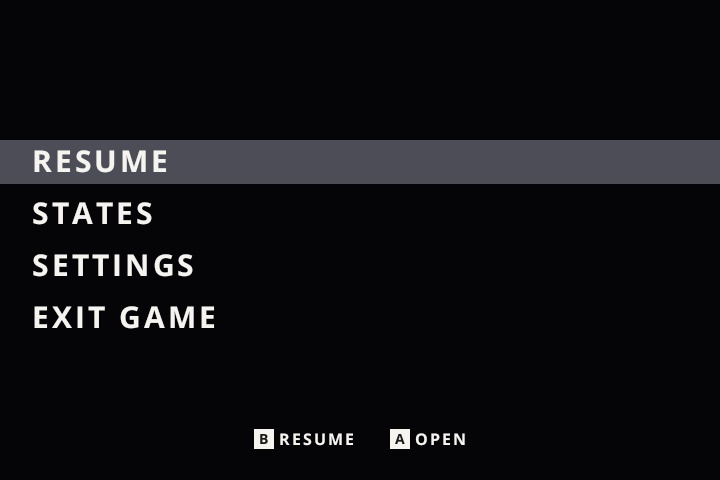
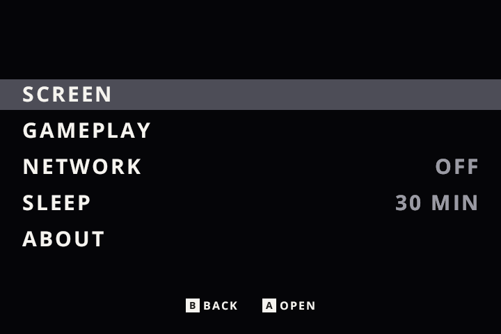
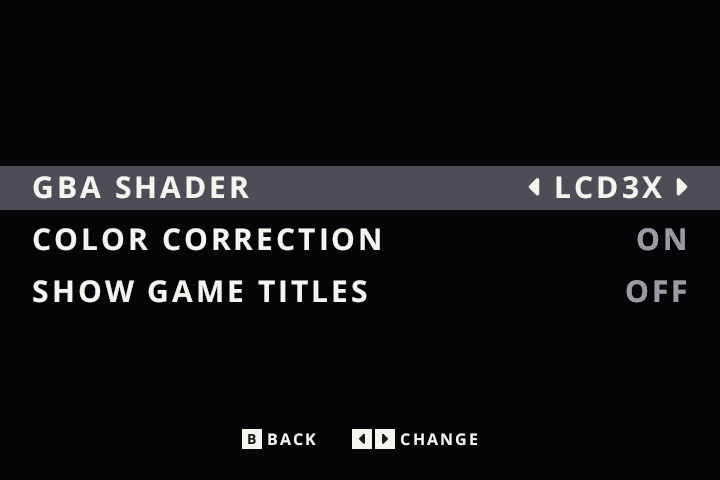
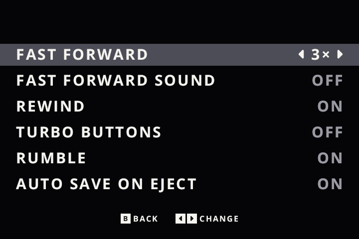
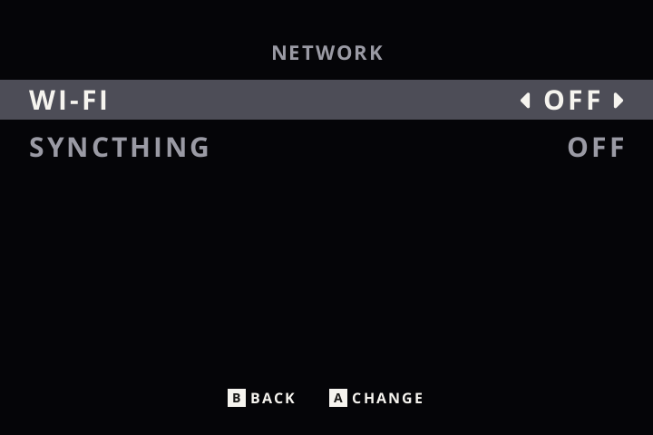
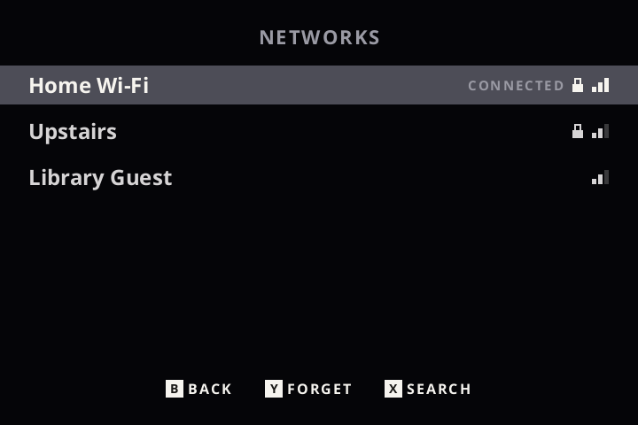
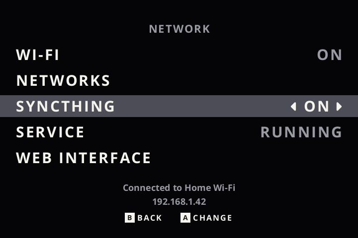
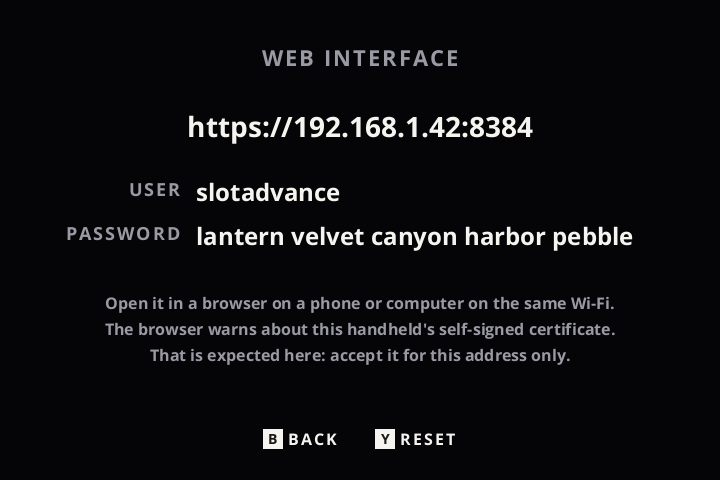

# slot.advance user guide

This guide explains how to use slot.advance on the **Anbernic RG SP (2026)**: the carousel, playing, the in-game menu, save states, sleep, settings, Wi-Fi, Syncthing, link play, the files it keeps and what to do when something goes wrong. It describes the current stable release. What changed in each version is in the [release notes](release-notes.md).

New to slot.advance? Start with the [README](../README.md), which covers what it is and [how to install it](../README.md#installing-and-updating). If you want to know how sleep and networking work inside, see the [Technical reference](technical.md); for how sleep and battery use were tested, see [Sleep and battery: how it evolved and how it was measured](sleep-and-battery.md).

**Reading the controls tables:** buttons side by side mean either one, and a `+` means both together. **New** marks what slot.advance adds or changes compared with [slot](https://github.com/BrandonKowalski/slot) 1.11.0.

## Contents

1. [The carousel](#the-carousel)
2. [Playing a game](#playing-a-game)
3. [The in-game menu](#the-in-game-menu)
4. [Save states](#save-states)
5. [Sleep, wake and automatic shutdown](#sleep-wake-and-automatic-shutdown)
6. [Settings](#settings)
7. [Game titles](#game-titles)
8. [Wi-Fi and networks](#wi-fi-and-networks)
9. [Syncthing: syncing Saves and States](#syncthing-syncing-saves-and-states)
10. [Link play](#link-play)
11. [Battery](#battery)
12. [Files on the games card](#files-on-the-games-card)
13. [Going back](#going-back)
14. [Troubleshooting](#troubleshooting)
15. [Known limitations](#known-limitations)
16. [Reporting a problem](#reporting-a-problem)
17. [Differences from slot](#differences-from-slot)

---

## The carousel

The carousel shows your games as cartridges on a shelf. It has three categories:

- **All:** every game on the card.
- **Recents:** the last 10 games started, newest first.
- **Favourites:** games you have starred. A gold star marks a favourite on the shelf.

After a reboot, the carousel opens on **the game you played last**, in the category you started it from.

 <b>Recents</b>, newest first (left), and <b>Favourites</b> (right)

Screenshots in this guide are rendered from slot.advance's own drawing code at the RG SP (2026)'s 720 x 480, with user-supplied Pokémon Unbound artwork and labels from the [starter pack](../artwork/gba-originals). Network names, addresses and passwords shown are invented examples.

With Wi-Fi on, a small Wi-Fi icon sits beside the clock: brighter arcs for a stronger signal, dimmed while not connected. With Wi-Fi off (the default) there is no icon.

| Button | What it does | |
|---|---|---|
| `Left` / `Right` | Move along the shelf | |
| `Up` / `Down` | Skip to the next letter | |
| `L2` / `R2` | Switch category: All, Recents, Favourites (empty ones are skipped) | **New** |
| `Y` | Add or remove the game from Favourites | |
| `L1` / `R1` | Same as `L2` / `R2` (and steps through GB and GBC shelves if you have those games too) | |
| Tap `A` | Resume where you left off | |
| Hold `A` | Start the game fresh | |
| `START` | Choose which emulator runs the cart (mGBA or gpSP) | |
| `MENU` | Settings | |

---

## Playing a game

Shader, colour correction and fast-forward changes made in game are saved **for that game only**. Games you have never changed follow the defaults in Settings. See [Per-game settings](#per-game-settings).

| Button | What it does | |
|---|---|---|
| Tap `MENU` | The [in-game menu](#the-in-game-menu): Resume, States, Settings, Exit Game. The game pauses | |
| Double tap `MENU` | Open the save-state switcher | |
| Hold `MENU` | Save, eject the cart and go back to the carousel | |
| `SELECT` + `R1` | Save a state (five per game, the sixth replaces the oldest) | **New** |
| `SELECT` + `L1` | Load the most recent saved state | |
| `SELECT` + `B` / `A` | Previous / next screen shader, named in a banner at the top | |
| `SELECT` + `Y` | Toggle colour correction | |
| `SELECT` + `L2` / `R2` | Slower / faster fast-forward (2x, 3x, 4x, 6x), for this game | **New** |
| `SELECT` + `X` | Fast-forward sound on / off, for this game | **New** |
| Hold `L2` | Rewind | |
| Hold `R2` | Fast-forward | |
| Double tap `R2` | Lock fast-forward on; press again to unlock | |
| Hold `X` / `Y` | Turbo A / Turbo B | |
| `SELECT` + `MENU` | [Link play](#link-play) with another device running slot (needs Wi-Fi on) | |
| Close the lid, or tap `POWER` | Save to the suspend slot and sleep. This never touches your five states | **New** |

### Anywhere

| Button | What it does |
|---|---|
| `SELECT` + `Up` / `Down` | Brightness |
| `SELECT` + `Left` / `Right` | Blue light filter |
| `VOL+` / `VOL-` | Volume |
| `VOL+` + `VOL-`, or `SELECT` + a volume key | Mute |
| Hold `POWER` for about a second | The power menu: **Restart** or **Power Off**. Your game is saved first. `Up` / `Down` to choose, `A` to confirm, `B` to close it. A shorter tap sleeps instead |

`POWER` does nothing while the lid is shut, or for 3 seconds after waking, so the press that woke the RG SP (2026) can't also open the menu. The power menu isn't available during link play.

---

## The in-game menu

 The <b>in-game menu</b> (left), and <b>Settings</b> opened from it (right). Date &amp; Time isn't offered during a game

**Tap `MENU` in a game** and the game pauses straight away. After a very short pause, so a double tap can still go straight to the save-state switcher, the menu appears. It always opens on **Resume**.

| Row | What it does |
|---|---|
| **Resume** | Close the menu and carry on playing |
| **States** | The [save-state switcher](#save-states), as a double tap of `MENU` opens it. `B` returns to the menu |
| **Settings** | The same Settings as on the carousel, over the paused game. See [Settings in a game](#settings-in-a-game) |
| **Exit Game** | Eject the game and go back to the carousel, as holding `MENU` does, saving it first if **Auto Save on Eject** is on (the default). Not shown when the card holds only one game, where ejecting isn't possible |

| Button | In the menu |
|---|---|
| `Up` / `Down` | Choose a row |
| `A` | Open it |
| `B` or `MENU` | Go back one level; from the menu itself, resume the game |
| Double tap `MENU` | Open the save-state switcher |
| Hold `MENU` | Eject and go back to the carousel, from any page (not with only one game on the card) |

While the menu or any page under it is open:

- **The game stays paused**, and no button reaches it. Fast-forward and rewind can't start behind the menu.
- **Brightness, blue light filter and volume** work as usual.
- **The usual automatic save** of the suspend slot carries on, as during play.
- **Closing the lid, or tapping `POWER`, saves and sleeps exactly as in a game.** When you open the lid, the game is still paused on the menu page you left (from the save-state switcher, on the menu). If you were on the **Network** screens or **About**, you come back to that row of Settings.
- **During link play**, tapping `MENU` does nothing: the menu can't open over a link session.

### Settings in a game

Settings in a game is the carousel's Settings, with a few differences:

- **Four rows belong to the game you're playing:** the screen **shader**, **Color Correction**, **Fast Forward** speed and **Fast Forward Sound**. They show and change that game's own value, just as the `SELECT` shortcuts do. Changing them on the carousel instead changes the default for games you have never changed. See [Per-game settings](#per-game-settings).
- **Every other row is the same global setting** as on the carousel: Rewind, Turbo Buttons, Rumble, Auto Save on Eject, Show Game Titles, Sleep and Network.
- **Hidden during a game:** **Date & Time** (the clock is only set with no game running), the **other platform's shader** (a GBA game shows only GBA Shader; a GB or GBC game only GB / GBC Shader) and **GB Palettes** (it only takes effect when a game starts). All three are on the carousel's Settings as usual.
- **Network** works in a game. Switching Wi-Fi on still needs a restart; if you choose **Restart** from a game, the game is saved first, and if it can't be saved, slot.advance doesn't restart and says so.

 In a GBA game, <b>Screen</b> shows only the GBA shader (left). On <b>Gameplay</b>, Fast Forward and Fast Forward Sound belong to the game; the rest are global (right)

---

## Save states

Each game keeps up to **five** manual save states. Saving a sixth replaces the oldest. They are separate from the game's own battery save and from the suspend slot used when the lid closes, which never replaces any of them.

 The <b>save-state switcher</b> (left), and the <b>delete question</b> it asks first (right)

Double tap `MENU` in game, or choose **States** in the in-game menu, to open the switcher.

| Button | What it does | |
|---|---|---|
| `Up` / `Down` or `Left` / `Right` | Newer / older state | **New** |
| `A` | Load the state on screen. Nothing loads just by moving to it | |
| `B` or `MENU` | Back to where you opened it from: the game, or the in-game menu | |
| `Y` | Delete: asks "Delete this state?" | |
| `Y` again | Confirm the delete. Any other button keeps the state | **New** |
| `X` | Undo the last save or load, up to 30 seconds after | |

If a game had more than five states from an earlier version, the oldest are moved to an `older` folder beside them rather than deleted. See [Files on the games card](#files-on-the-games-card).

---

## Sleep, wake and automatic shutdown

**Close the lid, or tap `POWER`, and the RG SP (2026) goes into real hardware sleep** (suspend-to-RAM). Your game waits in memory. Open the lid and it carries on from the same moment.

Before sleeping, slot.advance attempts to save your game to its separate suspend slot (`resume.state`). It never touches your five save states. If that save fails, the timer won't switch the RG SP (2026) off: see [Safety nets](#safety-nets).

The save always comes first. With Wi-Fi on, slot.advance then disconnects from the network and takes the Wi-Fi interface down before the RG SP (2026) sleeps, and reconnects after you open the lid. Syncing never holds up sleep. See [Wi-Fi and sleep](#wi-fi-and-sleep).

### Sleep duration

**Settings > Sleep** sets how long the RG SP (2026) stays asleep with the lid closed before it shuts down by itself.

| Setting | Asleep for up to | Projected battery used, if asleep the whole time |
|---|---|---|
| `3 min` | 3 minutes | under 0.2% |
| `15 min` | 15 minutes | ~0.5 to 0.8% |
| `30 min` (default) | 30 minutes | ~1 to 1.6% |
| `1 hr` | 1 hour | ~2 to 3.2% |
| `2 hr` | 2 hours | ~4 to 6.4% |
| `8 hr` | 8 hours | ~16 to 26% |

Mathematical projections at 2 to 3.2% an hour, the range of the three extended sleeps on 0.4.x with Wi-Fi off, not measurements at every duration. The longest sleeps observed were 16% over exactly 8 hours (0.4.0-beta.3), 20% over 7 h 46 min (0.4.0) and 24% over 7 h 37 min (0.4.1-beta.1). Real use varies with battery age, temperature and charge level. Longer settings are more convenient but use more battery. The measurements are in [Sleep and battery](sleep-and-battery.md#battery-results), and the 0.5.0 sleeps with Wi-Fi on in [0.5.0: Wi-Fi and Syncthing](sleep-and-battery.md#050-wi-fi-and-syncthing).

### Waking up: two kinds of resume

| | When | What happens |
|---|---|---|
| **Wake from RAM** | You open the lid before the sleep time runs out | The RG SP (2026) wakes and the game **carries on from the same moment**. It never stopped, so nothing is reloaded. |
| **Boot and restore** | The sleep time runs out with the lid still closed | The clock wakes it briefly and it **shuts down cleanly**. At the next power-on it boots and **restores the game from its suspend slot** (`resume.state`). This takes a few seconds longer, but you lose nothing. |

The sleep timer always ends with a shutdown, even on the charger.

With Wi-Fi off (the default), wakes from RAM are quicker, because slot.advance removes the switched-off radio's stale card from the system once at start-up. If that is missed for one session, wakes in that session take a little longer; see [Troubleshooting](#troubleshooting). With Wi-Fi on, the game is back almost as quickly (in development tests on a 0.4.2 test build modelling 0.5.0, a median of about 0.83 s against 0.82 s with Wi-Fi off), and Wi-Fi reconnects in the background.

If the [in-game menu](#the-in-game-menu) was open when the lid closed, the game wakes still paused on it.

### Safety nets

- **Unsaved games are never switched off by the timer.** If the game can't be written to the card when the lid closes, the RG SP (2026) keeps sleeping and retries the save; only the 5% battery shutdown can end it. The exception is a game slot.advance is deliberately not saving, because [the card couldn't read its save files](#when-a-save-cant-be-read) or because you [joined a link session](#link-play) with it: there is nothing to retry, so the timer can still switch it off, and that session's progress is lost. The same applies when the emulator refuses a game's suspend slot, for example an empty one: it is moved aside as `resume-refused-<time>.state`, the game starts fresh, and until the cart is put in again its suspend slot isn't written and save states are refused. The game's own saves still work.
- **Low battery:** sleep is planned to aim to preserve approximately 10% of the battery, waking and shutting down early if needed. At 10% or less it sleeps for 3 minutes. At 5% it saves and shuts down, as in slot. On the charger, sleep isn't shortened.
- **With the lid shut, `POWER` does nothing**, so the screen never lights inside a closed case. A charger or other stray wake sends it straight back to sleep, without reconnecting to Wi-Fi.
- **If hardware sleep isn't available or fails**, that sleep falls back to software standby: the screen goes dark, the system keeps running, and it shuts down after 3 minutes.
- Each sleep and wake is written to `slot.log` on the games card.

How all of this works inside is in the [Technical reference](technical.md).

### When a save can't be read

If a game's battery save, or its suspend slot (`resume.state`), is on the card but the card fails to read it, slot.advance protects the file rather than treating it as missing:

- The game starts **without** it, and the red **"Can't write to SD card / Progress is not being saved"** band appears.
- Until you take the cart out and put it in again, slot.advance writes **neither** file for that game: not at the automatic save, when the lid closes, on eject or at power off, and new save states are refused. Both are held back together, because a suspend slot also carries the battery save inside it. The file it couldn't read is never replaced with a blank one.
- Nothing you play in the meantime is saved. Closing the lid still sleeps, but if the sleep time runs out the RG SP (2026) shuts down without saving that session.

**What to do:** stop playing that game. Take the cart out and put it in again (hold `MENU`, or **Exit Game**), or Restart if the card holds only one game. Each insert reads both files afresh, so if the read works this time the band goes and saving carries on as normal. If the band comes back, power off, put the games card in a computer, copy `Saves`, `States` and `Config` somewhere safe, then check the card. A game with no save yet, such as one you've never played, never raises the band.

---

## Settings

Press `MENU` on the carousel. Most of Settings is also available in a game, through the [in-game menu](#settings-in-a-game).

| Setting | Where | Choices |
|---|---|---|
| Show Game Titles | Settings > Screen | Off (default) / On. See [Game titles](#game-titles) |
| GBA Shader, GB / GBC Shader, Color Correction, GB Palettes | Settings > Screen | As in slot. In a game, the shader and colour correction apply to that game only |
| Fast Forward, Fast Forward Sound, Rewind, Turbo Buttons, Rumble, Auto Save on Eject | Settings > Gameplay | As in slot. In a game, fast-forward speed and sound apply to that game only |
| Network | Settings > Network | Wi-Fi Off (default) / On, saved networks and Syncthing. See [Wi-Fi and networks](#wi-fi-and-networks) |
| Sleep | Settings > Sleep | `3 min`, `15 min`, `30 min` (default), `1 hr`, `2 hr`, `8 hr` |
| Date & Time | Settings > Date & Time | As in slot. Carousel only. With Wi-Fi on, the clock is also set from the network |
| About | Settings > About | The version, the number of games, free space on the games card, the battery, slotadvance.com and the credits |

Settings are saved in `Config/slot.state` on the games card, so they survive updates. You don't need to edit that file.

### Per-game settings

Each game remembers its own **shader, colour correction, fast-forward speed and fast-forward sound**. Change them in game, with the `SELECT` shortcuts (see [Playing a game](#playing-a-game)) or in [Settings in a game](#settings-in-a-game), and they apply to that game only.

The same rows on the **carousel's** Settings are the **defaults**: they apply to every game you have never changed. A game you have changed keeps its own value when the default changes. Game values are kept in `Config/game_profiles.txt`. Delete a game's lines there to put it back on the defaults.

The GBA screen shader is **off** by default: GBA is an exact 3x on the 720 x 480 screen, so it is already pixel perfect.

---

## Game titles

**Settings > Screen > Show Game Titles** puts the selected game's title in small text above its cartridge on the carousel.

<table>
<tr>
<td width="50%" align="center"> <b>Show Game Titles: Off</b> (the default)</td>
<td width="50%" align="center"> <b>Show Game Titles: On</b></td>
</tr>
</table>

- **Off by default**: with it off, the carousel looks exactly as before. Changes take effect straight away and are **remembered** after a restart (`show_titles` in `Config/slot.state`).
- **Only the selected cartridge** shows a title, centred above it in a fixed space, never over its neighbours.
- **The title comes from the file name**, minus naming tags such as `(USA)`, `(Rev 1)`, `(V1.1)` or `[!]`. Your files are never renamed: `Pokemon - Fire Red Version (U) (V1.1).gba` shows as **POKEMON - FIRE RED VERSION**.
- **Long titles** show cut short with "…" for 2 seconds, then scroll slowly to their end, pause, and start again. Scrolling stops while Settings is open or the device is asleep.

Rendered by slot.advance's own drawing code with labels from the [starter pack](../artwork/gba-originals); regenerate with `cargo run -p slot --no-default-features --example readme_titles`.

---

## Wi-Fi and networks

 <b>Network</b> with Wi-Fi off, the default (left), and the <b>Networks</b> list (right)

**Wi-Fi is off by default.** About 20 seconds after start-up, slot.advance switches the radio off completely, which keeps sleep at its most efficient and wake at its quickest. It also switches off six USB host controllers the RG SP (2026) has no ports for; the USB-C port has its own controller and still works for charging.

You need Wi-Fi only to sync with [Syncthing](#syncthing-syncing-saves-and-states), to have the clock set from the internet, or for [link play](#link-play).

### Switching Wi-Fi on and off

Open **Settings > Network** (on the carousel, or from the in-game menu) and set **Wi-Fi** to **On**.

- **Turning Wi-Fi on needs a restart.** You're asked to **Restart** now or **Later**; Wi-Fi turns on at the next restart either way. From a game, the game is saved before it restarts.
- **Turning Wi-Fi off works straight away**, and stays off after restarts.

The setting is kept in `Config/slot.state`, so it survives updates.

### Joining a network

With Wi-Fi on, open **Network > Networks**. It lists networks in range, with a lock for those that need a password and bars for signal strength. Press `X` to search again.

1. Choose a network and press `A`.
2. Type its password on the on-screen keyboard and choose **Join** (or press `START`).
3. When it connects, the Network screen shows **Connected to** the network and the RG SP (2026)'s address.

On the keyboard: `A` types the highlighted key, `B` deletes (and leaves when the field is empty), `X` types a space, `L1` / `R1` switch between lower case, capitals and symbols, and `Y` shows or hides what you've typed. The password is hidden by default.

- **Saved networks join by themselves** after a restart and after waking. Choosing a saved network that's in range switches to it.
- **To forget a network**, highlight it in the list and press `Y`.
- **Supported:** WPA2-Personal networks (most home routers and phone hotspots) and open networks without a password. Passwords can use any character on the keyboard (letters, digits, symbols and spaces).
- **Not supported:** WPA3-only networks (shown as **WPA3 only**: most routers can also offer WPA2, in a mode often called WPA2/WPA3 mixed or transitional), enterprise and WEP networks, hidden networks, and passwords with characters outside the keyboard.

### What Wi-Fi on does

- **The clock is set from the internet**, once each time you start, the first time it connects. It is only changed while no game is running, and the corrected time is also written to the RG SP (2026)'s own clock for the next start.
- **SSH is kept off.** The system software (BaseOS) can run an SSH server for logging in over the network, which on some versions uses a default password. slot.advance stops it before joining any network and keeps checking that it stays stopped while connected. If it can't be stopped, slot.advance doesn't connect.
- **The carousel shows a Wi-Fi icon** beside the clock.

### Wi-Fi and sleep

- When the lid closes, the game is **saved first**. slot.advance then disconnects and takes the Wi-Fi interface down before the RG SP (2026) sleeps. Nothing to do with the network can stop or delay sleep for more than half a second.
- When you **open the lid**, the game is back straight away and Wi-Fi reconnects in the background. In testing, reconnecting took about 6 to 13 seconds.
- A wake with the lid still shut (a charger, `POWER`) doesn't reconnect.
- Restart and Power Off disconnect from Wi-Fi and stop Syncthing first.

### Saved passwords

Networks you join are saved in `Config/wifi.txt` on the games card. slot.advance never stores the password you typed: it stores the network key worked out from it, which is what the RG SP (2026) needs to join. That key is not encrypted, and it works as well as the password for joining that network. **Anyone with your games card can use it to join your network**, so look after the card, and don't share `Config/wifi.txt` or a copy of the whole `Config` folder. Forgetting a network removes it from the file.

---

## Syncthing: syncing Saves and States

[Syncthing](https://syncthing.net) keeps folders the same on several devices. slot.advance includes it, set up to sync your **Saves** and **States** folders with your other devices on the same network: a computer, a home server or anything else that runs Syncthing.

 <b>Network</b> with Syncthing on and running (left), and the <b>Web Interface</b> screen (right)

### Turning it on

1. Switch **Wi-Fi** on and join a network (see [Wi-Fi and networks](#wi-fi-and-networks)).
2. In **Settings > Network**, set **Syncthing** to **On**. The first time, slot.advance sets Syncthing up on the games card, which takes a few seconds.
3. **Service** shows **Running** once it has started.

Syncthing runs only while Wi-Fi is on and the toggle is on, and only while the RG SP (2026) is awake. With Wi-Fi off, the Syncthing row is greyed out. **Service** says whether Syncthing itself is **Running**, **Stopped** or has an **Error**; it doesn't show whether syncing has finished. Use the web interface for that.

### Setting up syncing from a browser

Syncthing is set up in its **web interface**, from a phone or computer on the same Wi-Fi.

1. On the RG SP (2026), open **Network > Web Interface**. It shows an address such as `https://192.168.1.42:8384`, the user `slotadvance` and a password of five words.
2. On the phone or computer, type that address into a browser. The browser warns that the connection's certificate isn't trusted. That is expected here, because the RG SP (2026) makes its own certificate: accept it for this address only.
3. Log in with the user and password shown on the RG SP (2026).
4. **Add your other device.** In the web interface choose **Add Remote Device** and enter that device's ID (in Syncthing on that device, **Actions > Show ID**), or pick it from the nearby devices Syncthing suggests. Accept the RG SP (2026) on the other device too. The RG SP (2026) appears there as **slot.advance RG SP**.
5. **Share the folders.** On the RG SP (2026)'s web interface, edit **slot.advance Saves** and **slot.advance States**, open **Sharing** and tick your other device. Accept them on the other device and choose where they go there.

Syncing then runs by itself whenever both devices are awake and on the same network.

- **The password** is made up at random for each RG SP (2026), the first time Syncthing is set up. You can change the user name or password in the web interface (**Actions > Settings > GUI**). After that, the RG SP (2026) shows **Changed in the web interface** instead, because it can't read the new one back.
- **Forgotten the password?** On the Web Interface screen, while Syncthing shows **Running**, press `Y` (**Reset**) and confirm. You get a new password straight away; nothing else in Syncthing changes.
- **The web interface is only reachable while the RG SP (2026) is awake**, on the network it's connected to, and only through the HTTPS address shown, with the password. Everyone on that network can reach its login page, so use it on networks you trust, such as your home Wi-Fi.
- Syncthing on the RG SP (2026) looks for other devices on the **local network** only: internet discovery and relays are off. Both devices need to be on the same network to sync.
- Syncthing keeps its settings, keys and database in `Config/syncthing/` on the games card.

### What syncs, and when

- **Saves** (the games' own battery saves) and **States** (your save states and each game's suspend slot) are synced both ways. Games, settings and everything else on the card are not.
- **Syncing happens while the RG SP (2026) is awake.** It pauses while it sleeps, and carries on after you open the lid: Wi-Fi reconnects within seconds, and Syncthing reconnects to your other devices within about a minute.
- **Playing on more than one device:** eject the game (Exit Game, or hold `MENU`) before you carry on elsewhere, so its final save is written; check in the web interface that the other device shows **Up to Date**; and let incoming changes finish before you start the game there. slot.advance doesn't detect or merge conflicting changes itself.
- **Playing keeps syncing.** slot.advance saves each game's suspend slot about once a minute, so syncing States uploads roughly 25 MB an hour while you play (one test). Bear that in mind on a phone hotspot or a metered connection.
- **Battery:** Wi-Fi and Syncthing use more battery while you play. In one test, Wi-Fi added about 6 to 7% and Syncthing about 6% more, about 13% together (see [Battery](#battery)). They don't run while the RG SP (2026) sleeps.
- slot.advance adds an ignore list (`.stignore`) to both folders, so its own temporary files and the hidden files a Mac leaves behind (such as `.DS_Store` and `._` files) don't sync. Lines you add to it yourself are kept.

### Syncing is not a backup

Syncthing makes your devices match. That means it also copies **mistakes**: delete a state on the RG SP (2026), or have a save go wrong, and the same happens on your other devices once they sync.

**Keep an independent backup** of your Saves and States too, for example:

- copy the `Saves` and `States` folders from the games card to your computer from time to time; or
- switch on **File Versioning** for these folders in Syncthing **on your other device** (not on the RG SP), so it keeps older copies when files change or are deleted. Each game's suspend slot changes about once a minute while you play, so keep the versioning limited (for example **Staggered** or **Simple** with a small number of versions) to save space.

### File times and conflict copies

**Files copied onto the games card from a computer can show a shifted modified time** on the RG SP, and therefore on your other synced devices. The shift is the computer's difference from UTC (10 hours in Brisbane, for example), and the direction can vary between computers and time zones. This was found with files copied from a Mac through an SD card reader. Files the RG SP writes itself (in-game saves, states) and files that arrive through Syncthing keep correct times. On a Mac, files written by the RG SP can likewise show a shifted time.

What this means for syncing:

- **Normal syncing works.** When a save changes on one device and then syncs before it changes anywhere else, the newer save reaches every device, whatever the file times say. Syncthing follows the order of changes, not the times.
- **If the same save was changed in two places before they synced,** Syncthing keeps one version under the normal name and normally keeps the other beside it as a conflict copy, for example `Pokemon Emerald.sync-conflict-20261026-164646-ABCDEFG.sav`. Syncthing chooses by modified time, so a shifted time can decide which version the game loads by default.
- **If a save seems unexpectedly older,** look for conflict copies next to it. To use one, close the game, keep a copy of the current save somewhere safe, then rename the conflict copy to the save's normal name. slot.advance never loads or deletes conflict copies by itself.
- **Conflict copies are limited by Syncthing's settings.** Leave **Max Conflicts** in the folder's settings at its default; never set it to 0, which stops Syncthing keeping them.
- **Avoid changing the same save in two places** before the devices have synced, and avoid copying saves onto the card with a computer while that game is also being played on another synced device.

This is a known limitation, not a guarantee that every possible edit is kept: in one narrow case (an edited save with exactly the same size and the same time stamp as before) a change made with a computer can go unnoticed. The cause, the evidence and that case are described in the [Technical reference](technical.md#files-copied-from-a-computer-time-stamps).

---

## Link play

Link play (the link cable and the wireless adapter) runs over Wi-Fi between two devices running slot. With Wi-Fi off, the link shortcut shows **Link Off**.

1. Switch **Wi-Fi** on in **Settings > Network** and restart (see [Switching Wi-Fi on and off](#switching-wi-fi-on-and-off)). You don't need to join a network for link play.
2. In a game, press `SELECT` + `MENU` to host or join a link session, as in slot.

While a link session is open, it has the radio to itself: the RG SP (2026) leaves your home network, and Syncthing can't sync until the session ends. When the session ends, it reconnects by itself. The [in-game menu](#the-in-game-menu) can't open during link play.

### If you join a session

With mGBA (the default emulator), the RG SP (2026) that **joins** a session runs the host's game, with the host's save, for as long as the link needs it. So that the host's game can never be saved over yours, slot.advance stops writing **your** game's battery save and suspend slot once you join, and keeps them that way **until the cart comes out**, not just until the link ends:

- Your own saves stay exactly as they were before you joined.
- Nothing from that session is saved to your game, including anything you play after the link has ended. A sleep that runs out its timer shuts down without saving it.
- New save states and another link session are refused until then.

To carry on with your own game, take the cart out and put it in again (hold `MENU`, or **Exit Game**), or Restart if the card holds only one game. It starts from your own save and suspend slot as they were before you joined. Nothing on screen points this out yet; a reminder is planned for a later release. The host's saves work normally throughout.

---

## Battery

| Battery | What happens |
|---|---|
| 15% | A small "Battery Low: 15%" banner at the top of the screen |
| 10% | A small "Battery Low: 10%" banner |
| 5% | Your game is saved and the RG SP (2026) powers off, as in slot |

Each banner appears once per discharge, in game or on the carousel. Nothing appears while charging, and plugging in resets both. The battery is checked every 10 seconds, so after a sleep a banner shows within about 10 seconds of waking.

**While playing,** Wi-Fi and Syncthing use extra battery. In one development test with the same game and settings, the estimated current was about 445 mA with Wi-Fi off, 474 mA with Wi-Fi on and connected, and 501 mA with Syncthing also syncing Saves and States: roughly 7.9, 7.4 and 7.0 hours from a full battery for that test. These are estimates from the battery gauge for one workload, not guaranteed battery life. If you don't need syncing, Wi-Fi off gives the longest play.

How much battery sleep uses is under [Sleep duration](#sleep-duration), and what was measured is in [Sleep and battery](sleep-and-battery.md).

---

## Files on the games card

**Recommended format: exFAT.** This is the file system used during slot.advance development and testing. It applies to the games card (SD2) only: the system card (SD1) is written from the BaseOS image and should not be reformatted. The [slot guide](https://slot-cfw.fyi) also allows FAT32, with a Master Boot Record (MBR) partition scheme in either case. FAT32 may also work with slot.advance, but has not been fully validated.

| File or folder | What it holds |
|---|---|
| `Config/slot.state` | Your settings, including `sleep_minutes`, `show_titles`, `wifi` and `syncthing`. |
| `Config/favourites.txt` | Your favourites, one per line, e.g. `GBA/Mother 3 (Japan)`. Safe to edit on a computer. |
| `Config/recents.txt` | Recently played games, newest first. |
| `Config/game_profiles.txt` | Each game's own shader, colour correction and fast-forward choices. Delete a game's lines to put it back on the defaults. |
| `Config/wifi.txt` | Saved Wi-Fi networks and their network keys (not encrypted; see [Saved passwords](#saved-passwords)). Only there once you've joined a network. |
| `Config/syncthing/` | Syncthing's settings, keys, database and log. Only there once Syncthing has been turned on. |
| `System/bootlogo.bmp` | The slot.advance boot logo. Put your own 24-bit `.bmp` at `Config/bootlogo.bmp` to use that instead. See [artwork/bootlogo](../artwork/bootlogo). |
| `States/GBA/<core>/<game>/` | Up to five save states, named by the time they were saved, plus `resume.state`, the suspend slot used when the lid closes. |
| `States/GBA/<core>/<game>/older/` | States moved out of the switcher when a game had more than five from an earlier version. Nothing is deleted. |
| `Saves/GBA/` | Battery saves (`.sav` / `.srm`), exactly as in slot. |
| `Saves/.stfolder`, `Saves/.stignore`, and the same in `States` | Syncthing's folder marker and ignore list, added when Syncthing is turned on. |
| `slot.log`, `slot.log.1` | What slot.advance did this session and the one before, including each sleep and wake. The first line names the exact build: `slot advance` followed by the version, the commit and the build date. |
| `crash/` | Only appears if slot.advance itself has crashed: `cores.log` (one line per crash), the log of each of the last five crashed sessions (`slot-<date>_<time>.log`), and the most recent crash's `slot.core` and `slot.maps` for diagnosis. Safe to delete. |

The `.txt` files, `slot.state` and `syncthing` live in `Config/`, so replacing `System/` on an update leaves them alone.

The slot.advance **boot logo** appears from the second power-on: on the first start, slot writes it to the system card for the next boot, keeping the stock picture as a backup.

---

## Going back

All of a download's files are in its `System` folder: the slot.advance program (`System/slot`), the two emulator cores, Syncthing, the start-up and crash scripts, the boot logo and the licences. Its other folders are empty. Your games, saves, states, favourites and settings are never in `System`, so following the steps below leaves those files untouched. Compatibility is a separate question: older releases haven't been tested with files written by newer ones, so an earlier version may not understand every setting or file a later one created. Copying `Config`, `Saves` and `States` to your computer first is a simple precaution.

**Complete rollback (recommended).** This puts every program file back to the earlier release.

1. Download the earlier release from the [releases page](https://github.com/suprsomething/slot.advance/releases) and unzip it.
2. Power off the RG SP (2026) and put the games card (SD2) in your computer.
3. Open the download's `System` folder, select **everything inside it** and drag it into the `System` folder on the card. When asked, choose **Replace**.
4. Eject the card, put it back, and power on.

As when upgrading, only the contents of `System` need copying. On a Mac, don't drag the download's top-level folders (`Games`, `Saves`, `States` and so on) onto the card's folders of the same name: Finder's **Replace** would swap a whole folder for an empty one.

**Switch Wi-Fi off in 0.5.0 before going back** to an earlier release. Releases before 0.5.0 read Wi-Fi On as their old hidden link-play setting: they keep the Wi-Fi driver loaded and the radio powered, don't take Wi-Fi down before sleeping as 0.5.0 does, and can leave the screen dark after a Restart until `POWER` is held, the fault 0.5.0 fixed.

Releases before 0.5.0 have no Wi-Fi menu or Syncthing. Going back to one leaves `Config/wifi.txt`, `Config/syncthing/` and Syncthing's files in `System` in place, unused (if you later return to 0.5.0, switch Syncthing on again: earlier releases drop that setting); delete `Config/wifi.txt` if you no longer want your network keys on the card. Before 0.5.0, a `wifi=on` line in `Config/slot.state` kept the radio on for link play.

**Program only.** Copying just `System/slot` from an earlier release over `System/slot` on the card, or renaming the `slot.previous` you kept when upgrading back to `slot`, changes the program but leaves the newer cores and scripts in place. That mixed install is fine for a quick comparison, but it isn't the release as it was tested: for example, 0.4.2 also changed the gpSP core and the crash-capture script. Use a complete rollback before reporting a problem, because the version on the About screen and in `slot.log` names only the program.

---

## Troubleshooting

**The screen stayed dark after I flicked the lid open and shut quickly.** Close the lid and open it again. The game carries on without losing progress. Rapid flicks can occasionally leave the device asleep with the lid open, most likely because the lid was still moving when it was read. Normal opening is unaffected.

**Wakes felt slower for one session.** With Wi-Fi off, if the lid was closed at almost exactly the moment Wi-Fi switched off, about 20 seconds after power-on, the stale Wi-Fi card may not have been removed that session. Sleep and wake still work normally, just without the speed-up. The next power-on fixes it. `slot.log` shows `stale wifi card discard FAILED`.

**My game restarted from the suspend slot instead of carrying on.** The sleep time ran out, so the RG SP (2026) shut down and restored the game at the next power-on. Choose a longer **Settings > Sleep** time if you want it to stay asleep longer.

**I switched Wi-Fi on but nothing happened.** Turning Wi-Fi on takes effect at the next restart. Restart from the power menu (hold `POWER`) or from the Network screen.

**My network isn't in the list, or won't join.**
- Press `X` in **Networks** to search again, and move closer to the router.
- **WPA3 only:** the RG SP (2026) supports WPA2. Set the router (or phone hotspot) to WPA2/WPA3 mixed or WPA2 mode.
- **Couldn't join, check the password:** passwords are case sensitive; use `Y` to show what you've typed.
- Hidden networks can't be joined.

**The Web Interface page won't open in my browser.** Check that the RG SP (2026) is awake, connected (the Network screen shows **Connected to**) and that Syncthing shows **Running**. Use the full address shown, starting with `https://`, from a device on the same Wi-Fi. If the browser shows a certificate warning, that is expected: accept it for this address only.

**I've forgotten the web interface password.** On the Web Interface screen, while Syncthing shows **Running**, press `Y` (**Reset**) and confirm.

**Syncthing shows Error.** Turn Syncthing off and on again in **Settings > Network**. If it stays on Error, report it with `slot.log` and `Config/syncthing/syncthing.log`.

**My devices don't sync after waking.** Give it a minute: Wi-Fi reconnects within seconds of opening the lid, and Syncthing reconnects to your other devices within about a minute. Both devices need to be awake and on the same network.

**A save seems older than expected after syncing.** See [File times and conflict copies](#file-times-and-conflict-copies).

**The link shortcut shows Link Off.** Wi-Fi is off. See [Link play](#link-play).

**I want to go back to an earlier version.** See [Going back](#going-back).

**A red band says "Can't write to SD card / Progress is not being saved".** slot.advance can't save the game you're playing. It shows when the card has turned read-only, when a write to it failed (it clears once a later write works), or when the game's save or suspend slot couldn't be read. In every case, stop playing and see [When a save can't be read](#when-a-save-cant-be-read) for what to do.

**After link play, my game isn't saving and save states are refused.** You joined the session, so your own save is protected until the cart comes out. See [If you join a session](#if-you-join-a-session).

**slot.advance went back to the carousel by itself.** It probably crashed, and the RG SP (2026) started it again straight away. The game's battery save and suspend slot are as they were at the last automatic save, at most about a minute earlier, and your five save states are untouched. The details are kept in the `crash` folder on the games card; please [report it](#reporting-a-problem).

**Something else went wrong.** Don't power on again yet: `slot.log` and `slot.log.1` are replaced each time slot.advance starts. Copy them from the games card first, then follow [Reporting a problem](#reporting-a-problem).

---

## Known limitations

- **Rapid lid flicks** can occasionally leave the screen dark with the lid open. Deliberate stress testing reproduced this in both 0.4.0 and 0.4.1; normal opening is unaffected, and no progress is lost. [How to recover](#troubleshooting) · [Validation status](sleep-and-battery.md#validation-status).
- **The faster wake can be missed for one session** with Wi-Fi off, if the lid closes just as Wi-Fi switches off, about 20 seconds after power-on. Sleep and wake still work. [Details](#troubleshooting).
- **Battery figures come from the battery gauge**, which reads in whole 1% steps. The results are based on a small number of individual runs. See [Methodology and uncertainty](sleep-and-battery.md#methodology-and-uncertainty).
- **Switching Wi-Fi on needs a restart.** Switching it off doesn't.
- **WPA2-Personal and open networks only.** WPA3-only, enterprise, WEP and hidden networks can't be joined, and routers that require "protected management frames" with WPA2 are not expected to work.
- **Saved network keys are not encrypted** in `Config/wifi.txt`: anyone with the games card can use them to join those networks.
- **Syncthing syncs on the local network only**, and only while the RG SP (2026) is awake and Wi-Fi is on. It is not a backup: see [Syncing is not a backup](#syncing-is-not-a-backup).
- **Files copied onto the card from a computer can show shifted modified times.** Normal syncing works, but when a save was changed in two places before syncing, the shift can decide which version keeps the normal name. [Details](#file-times-and-conflict-copies).
- **After joining a link session, your game isn't saved until the cart comes out.** No reminder appears on screen yet. [Details](#if-you-join-a-session).
- **If a save or suspend slot can't be read, that game isn't saved until the cart is put in again**, so a file the card failed to read is never overwritten. The red card band shows meanwhile. [Details](#when-a-save-cant-be-read).
- **The sleep timer always ends with a shutdown**, even on the charger. The game is restored at the next power-on.

---

## Reporting a problem

1. **Don't power on again yet.** `slot.log` and `slot.log.1` are replaced each time slot.advance starts, so the record of the problem is on the card only until the next start or two.
2. Power off, take the games card (SD2) out and put it in your computer. Copy `slot.log` and `slot.log.1` from the top of the card somewhere safe. If there is a `crash` folder, copy `crash/cores.log` and the newest `crash/slot-….log` too. For a Syncthing problem, also copy `Config/syncthing/syncthing.log`.
3. [Open an issue](https://github.com/suprsomething/slot.advance/issues/new/choose) and choose **Bug report**. Say which version you're on (the first line of `slot.log`), what you were doing and what you saw, then drag the log files into the issue. Leave out `crash/slot.core`: it is large, and only needed if asked for. Never attach `Config/wifi.txt` or other files from `Config/syncthing/`: they hold your network keys and Syncthing's private keys. `slot.log` names the Wi-Fi networks you joined, but never their passwords.

---

## Differences from slot

This compares slot.advance 0.5.0 with **slot 1.11.0** (released 28 October 2026), upstream's latest release when this comparison was checked on 29 October 2026. Later upstream releases aren't reflected here. slot.advance 0.5.0's fixes from upstream were checked against 1.10.0; 1.11.0 changed none of the rows below.

**Why choose slot.advance:** you play GBA games on an RG SP (2026) and want real hardware sleep: close the lid and the game waits in memory for hours, opening it carries straight on, and a timed shutdown keeps the game safe. Wi-Fi stays off unless you want it, and Syncthing is built in for your saves and states. **Why choose slot:** you want its themes, wallpapers and bezels, remappable controls, screenshots or frame blending, or you have a different Anbernic handheld.

| | slot 1.11.0 | slot.advance |
|---|---|---|
| Lid closed | Software standby: the screen goes dark but the system keeps running, and it powers off after the **Lid Off** time, from 1 to 30 minutes | **Real hardware sleep** (suspend-to-RAM). Opening the lid carries on; it shuts down after the time set in **Settings > Sleep**, from 3 minutes to 8 hours |
| Wi-Fi | On whenever BaseOS starts it | **Off** by default; switched on, joined and forgotten in **Settings > Network**, and taken down before every sleep. See [Wi-Fi and networks](#wi-fi-and-networks) |
| Syncing saves | Not built in | **Syncthing** for Saves and States, set up in a browser |
| Unused USB host controllers | On | **Off** |
| In-game menu | Resume (with Undo Save or Undo Load for 30 seconds after one), States, Screenshots (once you have taken one), Settings and Exit Game, with a short Settings list of screen and gameplay rows | **Resume, States, Settings and Exit Game**, with the **full Settings** in a game (Date & Time, GB Palettes and the other platform's shader hidden), and the shader, colour correction and fast-forward rows **changing that game only**. `B` and `MENU` go back one level |
| Save states | 10 per game; deleting asks first (`Y`, then `X`) | **5** per game; `Up` / `Down` or `Left` / `Right`; deleting asks first (`Y`, then `Y`) |
| Per-game settings | Shader and colour correction are set for each platform (GBA, GB, GBC) and shared by all its games | **Each game remembers** its shader, colour correction, fast-forward speed and fast-forward sound |
| GBA screen shader | Grid by default | **Off** by default (GBA is an exact 3x on the 720 x 480 screen, so it is already pixel perfect) |
| Recents | Off until switched on in Settings | **On**, the last 10 games started |
| Controls | Remappable: in-game buttons, shortcuts and shelf keys | Fixed; shelves switch with `L1` / `R1` and also **`L2` / `R2`** |
| Low battery | A low-battery light from 20%; shuts down at 5% | A quiet **banner at 15% and 10%**, then the same 5% shutdown |
| About screen | A "back of the console" sticker | The **version, number of games, free space** on the games card and **battery** |
| Devices | Several Anbernic handhelds | The **RG SP (2026) only** |

**In both:** Favourites (`Y` stars a game onto its own shelf), a Recents shelf of the last 10 games, returning to where you were after a reboot (slot to the shelf and cart selected at power-off, slot.advance to the game you last played), optional game titles taken from the file name without its tags, an in-game menu on a tap of `MENU`, and unloading the Wi-Fi driver before Restart and Power off. slot fades the title into the shelf name; slot.advance shows it above the selected cartridge. Both also share everything slot.advance inherited: the cartridge shelf, the save-state switcher, rewind, fast-forward, link play, the two emulators and the power menu.

**Only in slot 1.11.0:** light and dark themes with bundled wallpapers and wallpaper tint, per-platform bezels, remappable controls, screenshots, frame blending, a picture Scale setting, a 1.5x fast-forward speed and a Fast Forward Toggle shortcut, Date & Time by city with daylight saving and a 12-hour clock, a Game Boy Advance Video shelf, a Load State on Insert setting, repairing a card that has turned read-only, held directions repeating in menus, and support for other Anbernic devices. slot removed its run-ahead option in 1.8.0.

**Where the shared features came from.** slot.advance was forked from slot on 9 October 2026, shortly after 1.5.0, so everything in slot up to then is Brandon T. Kowalski's work and that of slot's contributors. slot.advance's Recents is adapted from ciscosweater's community fork, slots, whose favourites tab also inspired slot.advance's Favourites. slot.advance's game titles and reopening on the last game were written for it. slot later added its own Favourites, Recents, remembered shelf and Game Titles in 1.7.0, built separately. slot.advance's in-game menu is adapted from slot 1.7.0's (the page, its rows, its pause and input guards, the short reveal delay and hiding Exit Game with one cart), with its own Settings.
